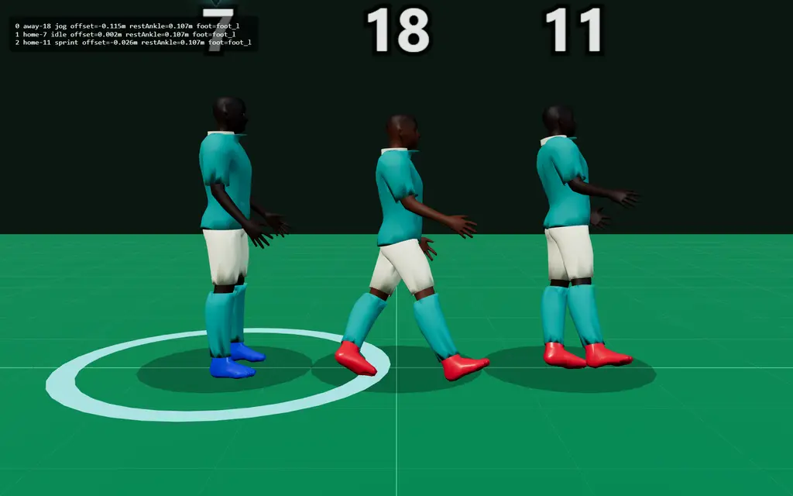
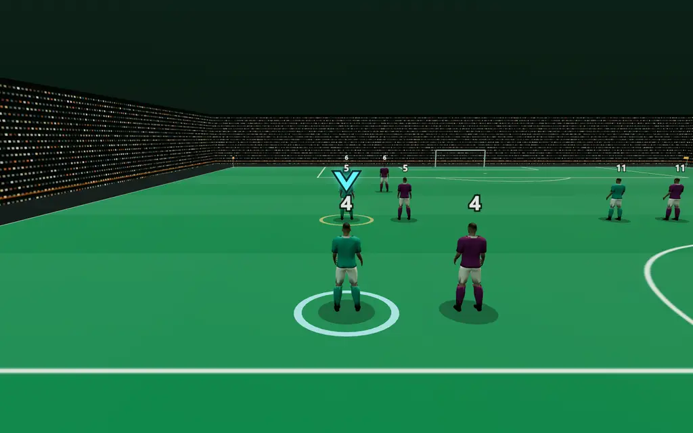
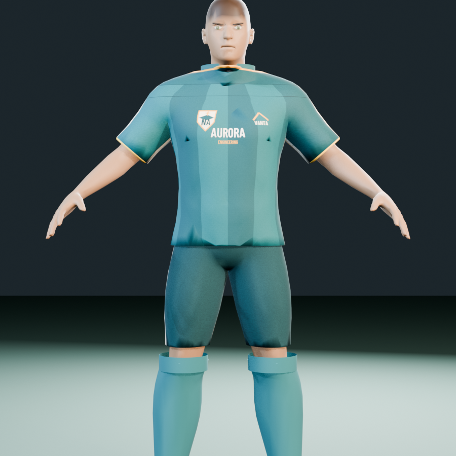

<!-- README.md -->
# Web Football

Private, LAN-only browser football game. The host machine owns the simulation;
both devices are thin clients. This repository is at **Milestone 35**:
server-authoritative matches, a live two-player team editor, the referee laws,
the data pipeline, a layered attribute-driven AI, selectable club and national
teams, a complete match-management layer with substitutions, injuries, added
time, extra time, shootouts, VAR-lite and full-time statistics, an animated
Three.js match presentation, multi-angle local replays and procedural audio.
M12 was the release pass: one-command packaging, full-match balance validation,
server/client performance profiling, bug fixes and final documentation. M13
adds host-owned referee/AI rules, a live rules readout and a manual pause
available to either seat that survives reloads and reconnects. M14 adds the
first authored player-character asset pipeline: a rigged, textured glTF player
built reproducibly in Blender and a presentation-only character lab. M15 wires
that authored rig into the Three.js match renderer through a decimated match
LOD, team palettes and a procedural bone-animation layer. M16 adds root-level
foot planting and deterministic per-player skin and boot colours. M17 delivers
the authored asset as WebP textures and warms the parsed template from the
lobby. M18 bakes the tested pose model into fifteen glTF animation clips and
plays them through a per-player mixer. M19 replaces root-only grounding with
per-leg analytic IK and world-space foot anchors during stance. M20 scales
authored clip playback to the speed the player actually covers. M21 adds
stride-locked footstep events and procedural contact audio. M22 places those
footsteps against the broadcast camera with stereo pan and distance gain. M23
calibrates stride cadence from each player's authored sprint speed. M24 adds
camera-distance player LOD and a bounded real-shadow budget for authored
players. M25 selects detail from projected screen size and throttles
skeletal animation for distant authored players while keeping their root
transforms at 60 Hz. M26 adds frustum-aware animation culling, adaptive shadow
pressure and a pass/fail render-budget gate. M27 adds a low-poly authored
template and a Lambert material fallback for minimal-detail players. M28 swaps
that geometry on the existing skeleton so animation and foot locks survive the
transition. M29 delivers meshopt-compressed match and low templates with an
uncompressed fallback and explicit compressed-byte, triangle and bone budgets.
M30 adds KTX2/Basis textures with a WebP/meshopt fallback chain. M31
cross-fades the high and low authored geometry instead of snapping between
them. M32 replaces the alpha-blend cross-fade with a screen-space dithered
geometry dissolve and pools transition resources. M33 moves that dither to a
static generated blue-noise texture, shares the transition cache across rigs
and lowers the dissolve budget automatically when frames are under pressure.
M34 anchors that pattern to each player's projected root so it no longer
slides across the screen as the camera moves.

## Requirements

- Node.js **20.19+** (CI runs Node 20; local development tested on Node 24)
- pnpm **10.18.3** (`packageManager` pins it)
- `mkcert` for a locally trusted HTTPS certificate
- Both devices on the same LAN, with the mkcert root CA trusted on the guest
- Optional, for rebuilding the player asset only: Blender 4.5+ and Python 3.10+
  with Pillow and NumPy. Normal install, build and play do not need either.
- Optional, for regenerating KTX2 textures: native **gltfpack 1.3** (the
  Windows release is a standalone `gltfpack.exe`). The committed KTX2 assets
  do not require it at install, build or play time.

Enable pnpm if needed:

```bash
corepack enable
corepack prepare pnpm@10.18.3 --activate
```

If corepack cannot write its shims (common on Windows without admin rights), use
`npm install -g pnpm@10.18.3`.

## Host and join

```bash
pnpm install
pnpm start
```

`pnpm start` builds the client, creates the mkcert certificate when missing,
builds the sample dataset when missing, then serves HTTPS/WSS. The first run may
prompt to trust the mkcert local CA. Use `pnpm certs` whenever the LAN IP
changes or the certificate needs refreshing; use `pnpm start --skip-build` for a
fast restart of an already-built client.

The server prints its local/LAN HTTPS URLs and a lobby QR. On the host:

1. Open the printed HTTPS URL.
2. **Create room**.
3. The terminal prints a room join URL and a scannable QR. Share either.
4. On the second device, scan the room QR (or open the URL/enter the 4-letter
   code). Both devices can pick distinct clubs, arrange the XI, bench,
   reserves, tactics and takers in the live editor.
5. Press **Ready** on both devices.
6. For touch play, open the printed **phone controller** URL (also shown in the
   room panel) instead of the lobby URL. The controller page occupies the second
   seat: move with the virtual stick and use Pass / Through / Lob / Shoot /
   Tackle / Switch / Sprint / Finesse buttons.

The match starts automatically when both players are ready. Host takes the home
side, guest takes away; the selected starting XI and formation are the ones the
server simulates.

`pnpm certs` installs/refreshes the mkcert local CA and writes
`certs/dev-cert.pem` + `certs/dev-key.pem` for `localhost`, `127.0.0.1`, `::1`
and every current LAN IPv4 address. If CA installation needs elevation, run
`mkcert -install` once in an elevated terminal, then
`pnpm certs -- --no-ca-install`.

Guest devices must trust the same mkcert root CA. On Windows, import the root CA
(`mkcert -CAROOT`) into the guest's trusted root store; on Android/iOS install it
as a trusted CA profile.

## Development

```bash
pnpm certs
pnpm dev
```

`pnpm certs` writes the Vite HTTPS certificate. If it is already present,
`pnpm dev` can be run directly.

- Lobby/match via Vite: **https://localhost:5173/**
- The match opens in the 3D renderer by default; append `?renderer=2d` to force
  the canvas renderer or `?renderer=3d` to force Three.js. The choice is also
  available from the match top bar and persists in `localStorage`. Without a
  WebGL context the client falls back to canvas and explains why
- Phone controller: **https://localhost:5173/controller.html**
- Player character lab: **https://localhost:5173/character.html**
- M1 local practice: **https://localhost:5173/practice.html**
- M0 transport check: **https://localhost:5173/link.html**
- Node HTTPS/WSS host: **https://localhost:8443/**

The Vite proxy forwards `/ws` and `/data` to the Node host. When playing across two devices
in dev, use the 5173 URL shown in the room UI; the terminal's room QR points at
the packaged 8443 origin.

Match-only local preview (no certificates, no WebSocket):

```bash
pnpm build
pnpm preview
```

## Commands

| Command | Purpose |
| --- | --- |
| `pnpm dev` | Server + Vite with HTTPS/WSS proxy |
| `pnpm build` | Build lobby, match, controller, practice and link pages |
| `pnpm preview` | Preview built lobby over local HTTP |
| `pnpm start` | Build/cert-check, then serve packaged pages + WSS over HTTPS |
| `pnpm start:server` | Serve the existing build without the launcher checks |
| `pnpm certs` | Generate mkcert certificate for localhost + LAN |
| `pnpm data:build` | Ingest sample CSV, mutate names, generate JSON/assets |
| `pnpm data:validate` | Validate generated JSON + cross-file references |
| `pnpm data:preview` | Map the sample XI into sim ratings and print it |
| `pnpm lint` | ESLint flat config, type-aware |
| `pnpm typecheck` | Root + every workspace package |
| `pnpm test` | Vitest unit/integration tests |
| `pnpm test:soak` | 1,000 headless AI-vs-AI matches; fails if averages miss targets |
| `pnpm perf` | 100-match deterministic simulation throughput benchmark |
| `pnpm character:build` | Rebuild the player GLB and support textures with Blender |
| `pnpm character:preview` | Rebuild and render the five character inspection frames |
| `pnpm check` | Lint + typecheck + tests |

Useful environment overrides:

| Variable | Default | Meaning |
| --- | --- | --- |
| `FB_HOST` | `0.0.0.0` | Server bind address |
| `FB_PORT` | `8443` | HTTPS/WSS port |
| `FB_CLIENT_PORT` | `5173` | Vite dev port |
| `FB_CERT_DIR` | `certs` | Certificate directory |
| `FB_STATIC_DIR` | `packages/client/dist` | Built client directory |
| `FB_DATA_DIR` | `data` | Generated public football data |
| `FB_REPLAY_DIR` | `replays` | Persisted goal-clip library and room index |
| `FB_DEV_LATENCY_MS` | `0` | Dev-only one-way latency for app messages/input |
| `FB_DEV_JITTER_MS` | `0` | Dev-only symmetric jitter around that latency |
| `FB_DEV_LOSS_PCT` | `0` | Dev-only percentage of binary snapshots to drop |
| `MKCERT_BIN` | `mkcert` | mkcert executable |
| `GLTFPACK_BIN` | unset | Native gltfpack 1.3 executable for KTX2 asset regeneration |
| `FB_SKIP_BUILD` | unset | Set `1` to skip the launcher's client build |
| `FB_SKIP_CERTS` | unset | Set `1` to fail instead of creating missing certificates |
| `FB_AUTO_CERTS` | unset | Set `0` to fail instead of creating missing certificates |

## Milestone 35 scope

Implemented:

- A feature-flagged temporal antialiasing resolve for the Three renderer.
  Enable it with `?taa=1`; `VISUAL_TUNING.temporalAa.enabled` defaults to
  **false** while motion-vector support is still outstanding
- The scene renders into an RGBA render target with a depth texture. A Halton
  subpixel camera jitter produces new samples, and a fullscreen resolve shader
  reprojects current depth through the previous view-projection into the
  ping-pong history buffer
- History is validated against the current 3 × 3 color neighborhood and
  rejected when the reprojected coordinate leaves the frame or lands behind
  the camera. The resolve mixes linear color, then the copy pass applies the
  sRGB transfer solely on output
- Camera mode changes, replay toggles, resizes and large camera translations
  or rotations reset history. The TAA targets are sized from the renderer's
  real drawing-buffer dimensions and resize with the canvas
- TAA is bypassed entirely when the flag is off, leaving the direct render path
  unchanged
- Verification:
  - `?taa=1` rendered the authored benchmark scene with matching color and
    brightness relative to the direct path; a 22-player run measured render
    average **8.31 ms**, p95 **11.50 ms**, gate **PASS** (direct path in the
    same environment: **7.62 ms**, p95 **9.20 ms**)
  - moving-player and camera-cut captures produced no script or shader errors;
    a camera-mode switch reset the history without a stale frame
  - `pnpm check` passes **706 tests**; the new tests cover the Halton sequence,
    jitter bounds and invalid pixel-size clamping
  - `pnpm build` succeeds
- Available with a development query parameter only; there is no production
  menu toggle yet

Known M35 limitations (by design):

- **No per-object motion vectors.** Player, ball and other moving geometry
  rely on depth reprojection plus the color clamp. Fast movement can still
  produce history smearing or edge softening; this is the main reason the
  feature defaults off
- The resolve has no stencil, velocity buffer or reactive-mask disocclusion.
  Newly revealed geometry falls back to neighborhood clamping rather than a
  principled disocclusion test
- The scene target is RGBA8 with no HDR or MSAA; tone mapping happens during
  the scene pass, and the final copy performs the linear-to-sRGB transfer
- Camera cuts are detected per frame by translation/rotation thresholds and
  explicit mode/replay/resize resets. A cut inside those thresholds can retain
  one stale sample
- Two fullscreen passes and a full-resolution history pair are allocated while
  TAA is enabled, independent of quality tier
- Transparent eye decals and netting are resolved as ordinary scene color; no
  special transparency handling
- TAA is not exposed in the settings UI and remains a query/tuning flag
- All M34 limitations remain outside the TAA path

## Milestone 34 scope

> M33's screen-anchored dither limitation is superseded by the player-anchored
> sampling below. A full TAA temporal resolve is still deferred: it needs
> motion vectors and a post-processing depth/history pipeline rather than a
> half-implemented shader blend.

Implemented:

- The blue-noise coordinate is now
  `floor(gl_FragCoord.xy) - uFbDitherAnchor` and is divided by the texture
  size. Source and target materials share the anchor, so the exactly-one-
  surface partition is unchanged
- `ThreeMatchRenderer` projects each player rig's root into drawing-buffer
  pixels in the same LOD pass that selects detail. It uses the renderer's real
  drawing-buffer size, not the CSS canvas size, and calls
  `setDitherAnchor` before any geometry transition starts
- `AuthoredPlayerRig` stores the anchor independently of a fade and applies it
  to every active source/target material. Moving the player or camera updates
  the anchor and therefore moves the pattern with the player. Pooled material
  clones receive the current anchor again when a new fade starts
- The shared skeleton, animation mixer, gait phase, foot locks and footstep
  clock are untouched
- Verification:
  - in the authored-rig probe, the controlled player's anchor settled at
    drawing-buffer pixel `(853, 253)` while an off-screen teammate had a
    distinct off-screen projection
  - switching to broadcast and moving the teammate from `(20, 10)` to
    `(80, 55)` moved that teammate's anchor from `(436, 556)` to
    `(1520, 232)`, independently of the controlled player
  - a frozen half-dissolve capture showed the anchored blue-noise stipple
    with no shader errors
- `pnpm check` passes **703 tests**; `pnpm build` succeeds
- Latest 22-player render benchmark: render average **8.88 ms**, p95
  **10.60 ms**, budget **16.70 ms**, **PASS**; frame average **16.64 ms**,
  p95 **16.80 ms**. Headless timings remain noisy; only optional KTX2 `HEAD`
  aborts were logged

Known M34 limitations:

- Anchoring is to the player's projected root, not to the skinned surface or
  its UVs. Root-relative animation and body rotation can still make the
  pattern slide across the shirt and limbs
- Off-screen or behind-camera roots produce large/negative anchor values;
  those fragments are not visible, but the uniform is not clamped
- There is still no TAA history, camera jitter, motion vectors or temporal
  resolve. The pattern is static per frame but not temporally accumulated
- All M33 limitations remain: 32 × 32 repeat, approximate blue-noise
  generator, transparent eye decals, shared palette clone retention, deferred
  transitions under pressure, standard shader-chunk assumptions, reversal
  snapping and no real fade-target shadows

## Milestone 33 scope

> M32's per-rig transition pools and fixed dissolve cap are superseded by
> M33. The dither remains screen-anchored; this milestone does not add TAA.

Implemented:

- The dissolve threshold comes from a deterministic **32 × 32 blue-noise
  texture** generated at load time by tileable farthest-point sampling. It is
  sampled with nearest filtering and repeat wrapping from the fragment's
  screen coordinate. There is no per-frame random hash, so a stationary
  camera and player produce a stable pattern
- Source and target materials still evaluate the same texture coordinate and
  complementary cutoffs, preserving the exactly-one-surface partition.
  Opaque materials stay opaque and depth-writing
- `AuthoredPlayerLibrary` owns one shared `GeometryDissolvePool`:
  - outgoing and incoming material clones are cached by original material
  - temporary `SkinnedMesh` targets are cached globally, rebound to the live
    skeleton on acquisition, and unbound when released
  - per-rig skin/boot and cheap-material clones are dropped from the shared
    cache when that rig is disposed; shared palette materials remain cached
- The global dissolve budget is now adaptive:
  - normal cap **6**
  - frame-budget-pressured cap **3**
  - `ThreeMatchRenderer` configures the budget from the previous frame's
    pressure state before applying LOD
  - deferred transitions still retry automatically
- The shared skeleton, mixer, gait phase, foot-lock state and footstep clock
  remain untouched.
- Verification:
  - 32 × 32 rank generator is deterministic, covers `0..254`, and produces a
    repeat/nearest-filtered `DataTexture`
  - a half-dissolve authored-rig capture showed blue-noise stipple at the
    silhouette with no alpha ghosting and no shader errors
  - first rig entering low detail left 6 free fade meshes and 16 material
    clones in the shared pool; a second same-team rig reused all 6 fade
    meshes, leaving the free-mesh count at 6. Its distinct skin/boot materials
    correctly created additional entries
  - entering high detail grew the free-mesh pool only to the number of target
    slots that need high geometry
  - material/mesh free-list reuse, double-release protection, per-rig source
    eviction and the adaptive budget (including invalid-cap clamping) are
    covered by unit tests
- `pnpm check` passes **703 tests**; `pnpm build` succeeds
- Latest 22-player render benchmark: render average **9.08 ms**, p95
  **10.80 ms**, budget **16.70 ms**, **PASS**; frame interval average
  **16.64 ms**, p95 **16.80 ms**. Headless benchmark timings vary noticeably
  between runs; the gate remains green. Only the optional KTX2 `HEAD` aborts
  were reported

Known M33 limitations (by design):

- The blue-noise pattern is still locked to screen space. A moving camera can
  make it slide across a surface; there is no player-anchored sampler or TAA
  accumulation yet
- The 32 × 32 texture repeats every 32 screen pixels. It is static and
  deterministic, but large close-ups can reveal the repeat
- The generator is a progressive farthest-point rank, not a full
  void-and-cluster blue-noise optimiser
- Transparent eye decals continue to alpha-blend beneath the dissolve
- The shared cache retains free material clones for shared palette colours
  until library disposal. Per-rig colours are evicted on rig disposal, but
  repeated team selections can still accumulate palette keys
- The adaptive cap can defer low-detail transitions under pressure; those
  players stay at high geometry until budget is available
- Shader injection still assumes Three's standard `void main()` and
  `alphatest_fragment` chunks
- Reversals and material-LOD changes still finish the current dissolve before
  starting another
- Fade target meshes do not cast real shadows

## Milestone 32 scope

> The M31 alpha-blend ghosting and no-pooling limitations are superseded by
> M32.

Implemented:

- The high/low geometry transition is now a **screen-space dithered dissolve**
  instead of a transparent cross-fade. Both surfaces evaluate the same
  coordinate hash; the outgoing surface survives below a moving cutoff and the
  incoming surface survives above it. Every pixel is drawn by exactly one
  level, so there are no double-covered or missing pixels in the middle of the
  transition
- Opaque source materials stay opaque and depth-writing. Eye-decal materials
  keep their original transparency mode. The shader is injected only into
  temporary fade clones; source materials, opacity, alpha test and depth
  settings are never mutated
- Transition resources are pooled per rig:
  - one reusable fade target `SkinnedMesh` per geometry slot, rebound to the
    live skeleton whenever a dissolve starts
  - outgoing and incoming material clones cached by their original material
    and by dissolve side
  - low/high/low/high transitions reuse the same meshes and clones; pools are
    disposed with the rig
- A global cap keeps at most **6** geometry dissolves active at once. Deferred
  starts leave the committed level different from the visual level, so the
  next LOD pass retries. A late-arriving low template follows the same retry
  path. No transition is dropped permanently
- The shared skeleton, animation mixer, gait phase, foot-lock state and
  footstep clock remain untouched by both the dissolve and the pooling
- Synthetic authored-rig verification:
  - high: 10 visible skinned meshes
  - high → low start: 16 visible meshes, 6 pooled fade targets, 8 outgoing and
    6 incoming material clones, progress 0
  - high → low half: progress 0.5, 16 visible meshes, all fade uniforms 0.5;
    close-up showed a stippled silhouette and no alpha ghosting
  - low end: 6 visible meshes, geometry low, 0 fade meshes in the scene
  - low → high → low → high: pool sizes stabilized at 10 fade targets, 8
    outgoing and 8 incoming material clones; no per-transition growth
  - 9-rig cap probe: exactly 6 rigs started dissolving, the other 3 remained
    committed/visual high; the next request started the remaining 3
- `pnpm check` passes **698 tests**:
  - complement/discard rules for the dither partition
  - edge clamping and invalid fade durations
  - dissolve budget admission and invalid-cap handling
  - shader-uniform injection, opacity/depth preservation and distinct program
    cache keys for incoming/outgoing materials
- `pnpm build` succeeds
- Latest 22-player render benchmark: render average **5.06 ms**, p95
  **6.10 ms**, budget **16.70 ms**, **PASS**; frame interval average
  **16.64 ms**, p95 **16.80 ms**. The optional KTX2 HEAD aborts remain
  non-fatal; no script or shader errors were observed

Known M32 limitations (by design):

- The dither pattern is locked to screen space, not surface UVs. It is stable
  frame to frame but can shimmer as the camera or player moves across it; there
  is no TAA or blue-noise temporal filter
- High and low silhouettes are partitioned at pixel granularity, so silhouette
  edges visibly stipple during the 0.18 s transition. Interior pixels usually
  look solid because the two levels share colours
- Transparent submeshes such as eye decals still use alpha blending beneath the
  dissolve. This is acceptable for their small screen area but is not a full
  order-independent transparency solution
- The cap can defer low-detail transitions for a few frames when many players
  cross the threshold together. The deferred players stay on high geometry
  until the next LOD pass obtains budget
- Pools are per rig. A rig may retain up to one target mesh per geometry slot
  and two material clones per distinct source material until it is disposed;
  there is no cross-rig cache
- The shader injection assumes Three's standard fragment chunks, specifically
  `void main() {` and `#include <alphatest_fragment>`. Custom ShaderMaterials
  are out of scope
- Reversals during a dissolve still finish the current target before starting
  the reverse, and a material-LOD change still completes the dissolve
- Fade target meshes do not cast real shadows; authored players keep the blob
  shadow

## Milestone 31 scope

Implemented:

- `AuthoredPlayerRig` now dissolves between the high and match low templates
  over **0.18 s**. The outgoing geometry stays on the existing meshes with
  transparent material clones; the incoming geometry is a temporary
  `SkinnedMesh` bound to the same high-template skeleton
- Both sides share the live skeleton, animation mixer, gait phase, foot locks
  and footstep clock. Starting or finishing a dissolve does not reset any
  animation or physical presentation state
- High-only meshes such as eye decals and eyebrows fade out when entering low
  detail and fade back in when returning to high. Low-only slots do not exist
- Material opacity is eased linearly by `geometryFadeProgress`. Originals are
  never mutated: every source and target material is a temporary clone with
  its own base opacity, disposed when the dissolve finishes
- `ThreeMatchRenderer` advances the dissolve from the actual render delta every
  frame. The 10-frame geometry hysteresis and the animation-stride throttling
  remain independent, so distant players still dissolve even when their
  skeleton updates are skipped
- Material LOD changes complete an in-flight dissolve rather than leaving
  transparent materials attached. A reversal during a dissolve finishes the
  current target and starts a new transition; the hysteresis makes this
  uncommon
- Synthetic rig smoke:
  - high: 10 visible skinned meshes
  - low dissolve start: 16 visible meshes, high source opacity 1, low target 0
  - low dissolve half: 16 visible meshes, all source/target opacities 0.5
  - low end: 6 visible meshes, geometry low, no fade meshes or temporary
    materials
  - high dissolve start: 16 visible meshes, low source 1, high target 0
  - high half: all 16 at 0.5
  - high end: 10 visible meshes, geometry high, no fade meshes
  - No script errors; close-up screenshots showed the intended ghosted
    halfway dissolve
- The 22-player render benchmark remains **PASS**. Latest run: render average
  **8.51 ms**, p95 **10.00 ms**, budget **16.70 ms**; frame interval average
  **16.64 ms**, p95 **16.80 ms**. Repeated runs ranged from 6.43–8.64 ms
  average, so the renderer remains under budget but the benchmark is noisy
- `pnpm check` passes **689 tests**; the two new geometry-fade progress tests
  cover clamping and invalid durations. `pnpm build` succeeds

Known M31 limitations (by design):

- The dissolve is an alpha blend, not a dithered or alpha-hashed transition.
  Two overlapping skinned surfaces at 50% can show ghosting and transparent
  sorting artefacts, especially on the face and kit edges
- Each active dissolve temporarily doubles that player's skinned draw calls
  and allocates geometry-target meshes and material clones. Resources are
  disposed at the end, but there is no per-rig pool yet
- The target mesh shares the high-template bind matrices and skeleton. The
  low geometry must keep the same bone order and bind pose established by M28
- A reversal in the middle of a dissolve snaps to the current target before
  starting the reverse transition. The 10-frame hysteresis reduces, but does
  not eliminate, this case
- A material-LOD change during a dissolve finishes the dissolve immediately,
  which can produce a one-frame material switch
- The public `geometry` value reports the outgoing level during the dissolve
  and the incoming level only at completion
- Fade target meshes never cast real shadows; authored players still use the
  blob shadow
- There is no resource pooling or adaptive cap for many simultaneous
  transitions; every player crossing the minimal threshold starts one

## Milestone 30 scope

> The M29 limitation that KTX2/Basis textures were not implemented is
> superseded by M30.

Implemented:

- `tools/character/pack_ktx2.py` converts the authored GLB's embedded WebP
  images to temporary PNGs, runs native gltfpack 1.3 with `-tc -noq -kn -km
  -ke`, and repairs the result:
  - every texture points at `KHR_texture_basisu`
  - `EXT_texture_webp` is removed from the required extensions
  - the source mesh names are restored after gltfpack strips the mesh-array
    names
- Two KTX2 templates ship:
  - `player-01-match.ktx2.glb`: **795,852 bytes**, **28.4%** smaller than the
    original **1,111,124-byte** WebP match template and 13.3% smaller than the
    meshopt variant
  - `player-01-low.ktx2.glb`: **650,260 bytes**, **29.6%** smaller than the
    original **923,976-byte** low template and 19.2% smaller than the meshopt
    variant
- The match KTX2 file contains **5 KTX2 images**, the low file **4 KTX2
  images**, both with 15 animation clips. Triangle counts remain **7,385** and
  **3,491**
- The client loads KTX2 first, then the existing meshopt WebP template, then
  the original WebP template. A meshopt or plain load is used when the KTX2
  decoder, WebAssembly, workers, transcoding or the file itself fails
- `KTX2Loader` is initialised once and points at the vendored
  `public/basis/basis_transcoder.{js,wasm}`. Because the lobby preloads assets
  before a match renderer exists, support detection probes a throwaway WebGL
  context and immediately releases it. The shared KTX2 loader is retained for
  the app lifetime
- `tools/character/build.mjs` regenerates KTX2 files when `GLTFPACK_BIN` points
  at a native gltfpack binary. Without it, the build reuses the committed KTX2
  files and fails only when they are missing or over budget:
  - match KTX2: **900,000 bytes**
  - low KTX2: **700,000 bytes**
- Browser smoke:
  - KTX2 lab: `delivery=ktx2`, 15 clips, **7,385 triangles**, **1.80 m**
    bounds; the authored kit, crest prints and skin rendered correctly
  - With both KTX2 files removed, the same lab loaded `delivery=meshopt` with
    the same clip and triangle counts
  - With `basis_transcoder.wasm` temporarily missing, the decoder preflight
    rejected KTX2 and the loader selected meshopt without hanging
  - The 22-player benchmark measured render average **4.77 ms**, p95 **6.30
    ms**, budget **16.70 ms**, gate **PASS**; frame interval average **7.67
    ms**, p95 **18.20 ms**
  - The benchmark reported no page errors
- `pnpm check` passes **687 tests**, including three new KTX2 integrity tests
  for required extensions, image signatures, mesh names, animation count and
  byte ceilings; `pnpm build` succeeds

Known M30 limitations (by design):

- KTX2 regeneration requires native **gltfpack 1.3**, which is not vendored.
  The committed assets are used as-is when `GLTFPACK_BIN` is unset; the build
  does not compare them with a freshly regenerated source GLB
- gltfpack uses ETC1S texture encoding. It is lossy and normal maps are not
  separately promoted to UASTC, so close inspection may show compression
  artifacts
- gltfpack still optimises vertices and resamples animation clips at its
  default 30 Hz, even with `-noq`. The resulting clips are presentation-only
  and are not used by the simulation
- The KTX2 chain increases shipped files: original WebP, meshopt and KTX2
  variants all remain in `dist/characters/`, plus a **585 KB** Basis transcoder
- Support detection uses a throwaway context and a conservative fallback; a
  browser with a working KTX2 path may still fall back if the transient
  context cannot be created
- The KTX2 and meshopt byte budgets are build checks; runtime budget violations
  remain warnings, and `HEAD`/`Content-Length` availability is not guaranteed
- There is still no opacity cross-fade between geometry LODs
- KTX2Loader and the decoded template cache live for the whole app lifetime;
  there is no eviction or disposal on returning to the lobby

## Milestone 29 scope

> The M28 limitation that Draco/meshopt/KTX2 were not implemented is
> superseded for geometry by M29. Textures remain WebP; KTX2 is still not
> implemented.

Implemented:

- Blender now writes meshopt-compressed variants alongside the uncompressed
  templates:
  - `player-01-match.meshopt.glb`: **917,640 bytes**, down from **1,111,124**
    bytes (17.4% smaller), using `EXT_meshopt_compression`
  - `player-01-low.meshopt.glb`: **804,312 bytes**, down from **923,976**
    bytes (13.0% smaller)
- The client attaches `MeshoptDecoder` to the `GLTFLoader` and requests the
  compressed files first. If the compressed file is missing, the decoder is
  unavailable, or parsing fails, `authored-asset.ts` logs the reason and
  retries the same template from the uncompressed URL. The procedural rig
  remains the final fallback
- The HTTP budget probe records the compressed byte size with a `HEAD` request.
  `asset-budget.ts` checks each parsed template against explicit ceilings:
  - compressed bytes: match **1,000,000**, low **900,000**
  - decoded triangles: match **8,000**, low **4,000**
  - skeleton bones: **64**
- Budget violations are warnings, not silent failures. The loaded template is
  still rendered, and the warning names every exceeded dimension. A missing
  `Content-Length` skips only the byte check
- `tools/character/build.mjs` fails the asset build when either compressed
  variant is missing or exceeds its byte ceiling, then copies both variants
  into `packages/client/public/characters/`. `pnpm character:build` reproduced
  the assets and passed both checks
- Fallback smoke: with both `.meshopt.glb` files temporarily removed, the
  client logged meshopt load failures, fetched the **1,111,124-byte** match
  template and **923,976-byte** low template, and rendered the 22-player
  benchmark without page errors
- `pnpm check` passes **684 tests** (the three new budget tests cover accepted
  values, every exceeded dimension, and an unknown byte size); `pnpm build`
  succeeds
- The compressed-template benchmark measured render average **5.15 ms**, p95
  **7.20 ms**, budget **16.70 ms**, gate **PASS**, frame interval average
  **9.01 ms** and p95 **24.20 ms**. The p95 frame interval is above the target
  and varies between runs; the CPU render-budget gate still passes

Known M29 limitations (by design):

- Meshopt compresses geometry and animation buffer views only. Embedded WebP
  textures dominate both files, so the byte reduction is modest. KTX2/Basis
  texture compression is still not implemented
- The decoder is a bundled WebAssembly module. Browsers without WebAssembly or
  with a blocked decoder fall back to the uncompressed downloads
- Both compressed and uncompressed files are shipped in `dist/characters/`.
  Only one variant is downloaded per page load, but the deployment contains
  both copies
- The byte budget relies on a successful `HEAD` response and `Content-Length`;
  the triangle and bone budgets are computed after parsing. These are runtime
  warnings, not hard upload rejections
- There is no service-worker integer-byte cache or streaming progress UI for
  the compressed downloads
- This milestone does not add an opacity cross-fade between geometry LODs or a
  KTX2 texture pipeline

## Milestone 28 scope

Implemented:

- Minimal-detail geometry now swaps **in place** on the existing high-template
  skinned meshes. The low template provides replacement `BufferGeometry`
  objects keyed by mesh name; the rig assigns them to the same `SkinnedMesh`
  objects instead of disposing and recreating the rig
- The shared skeleton, animation mixer, active clip, gait phase, foot-IK locks
  and footstep clock all survive a high↔low transition. High-only meshes such
  as eye decals and eyebrows are hidden while low geometry is active and
  restored afterward
- Low geometry can attach after a rig already exists. The renderer calls
  `attachLowTemplate` when the low asset finishes loading, and the rig applies
  the current geometry level immediately. No per-rig low-template copy is
  created; all rigs share the template geometries
- The existing **10-frame geometry hysteresis** remains. It prevents threshold
  flicker from swapping geometry repeatedly, but no longer causes an animation
  reset when it does change
- The low template is independent geometry but not an independent skeleton at
  runtime: the high-template rig, bones, mixer and materials remain the single
  source of truth
- Manual player-camera smoke:
  - full/high: **7,561 triangles** including overlays, `MeshStandardMaterial`,
    animation running
  - forced low: **4,395 triangles** including overlays, correct posed
    silhouette, the same active `jog` action still running
  - restored high: **7,561 triangles**, same rig, geometry back to high
  - no page errors
- A 22-player benchmark after the swap refactor measured render average
  **5.15 ms**, p95 **7.40 ms**, budget **16.70 ms**, gate **PASS**, frame
  interval average **8.10 ms** and p95 **18.20 ms**. The p95 frame interval
  exceeds the target while the CPU render gate still passes
- `pnpm check` passes **681 tests**; `pnpm build` succeeds. No simulation,
  protocol, replay or collision behaviour changed

Known M28 limitations (by design):

- This is a hysteresis-gated geometry **swap**, not an opacity/vertex
  cross-fade. The silhouette changes at the swap frame
- Low and high geometries must share the same skeleton bind order and rest
  pose. The shipped templates do; a future asset rebuild must keep that
  contract or the swap can deform
- High-only meshes disappear immediately when low geometry activates; there is
  no per-mesh fade
- The low asset is still **903 KB**, uncompressed, with embedded WebP textures
  and animation clips. Draco/meshopt/KTX2 are not implemented
- The 10-frame hysteresis still permits a visible change for a player hovering
  near the minimal-size threshold
- Material LOD remains Lambert-only at minimal detail. Full and reduced detail
  stay PBR
- Automatic low-template attachment runs once per rig when the template becomes
  available; a later low-template failure cannot be repaired at runtime
- The benchmark gate is manual and measures CPU `renderer.render()` p95, not
  GPU completion or CI timing

## Milestone 27 scope

> The M27 limitation about rig recreation was superseded by M28's shared-skeleton
> geometry swap.

Implemented:

- The Blender pipeline now exports a third authored template,
  `player-01-low.glb`, after the existing match LOD. It has **3,491
  triangles**, **6 meshes**, the same **53-bone skeleton**, the same 15 clips
  and the same palette material names. It removes the eye decals and eyebrows
  and decimates the remaining six meshes again
- `authored-asset.ts` loads the match and low templates together. The lobby's
  existing warm-up preloads both; a low-template failure keeps the match
  template and the procedural fallback intact
- `player-geometry.ts` maps only `minimal` detail to the low template. Full
  and reduced detail keep the match mesh
- Geometry changes have a **10-frame hysteresis**. The renderer waits for the
  desired geometry to remain stable before disposing and recreating the rig,
  so detail flicker at the screen threshold cannot churn skeletons every frame
- `authored-material-lod.ts` builds a per-rig `MeshLambertMaterial` fallback
  for minimal detail. It preserves albedo, map, transparency, alpha test,
  side, depth policy and vertex colours, but drops normal maps and the
  standard-material fragment path. Cheap materials are owned and disposed with
  the rig; restoring full or reduced detail restores the original materials
- The player-camera smoke verified both paths:
  - visible controlled player: `full`, high geometry, **7,561 triangles**
    including overlays, `MeshStandardMaterial`, material LOD off
  - off-screen player: `minimal`, low geometry, **3,667 triangles** including
    overlays, `MeshLambertMaterial`, material LOD on
  - low and high templates both reported ready; no page errors occurred
- A 22-player benchmark after loading both templates measured render average
  **9.83 ms**, p95 **15.60 ms**, budget **16.70 ms**, gate **PASS**, frame
  interval average **16.70 ms** and p95 **16.90 ms**
- `pnpm check` passes **681 tests**; `pnpm build` succeeds. No simulation,
  protocol, replay or collision behaviour changed

Known M27 limitations (by design):

- Low and high templates have independent skeletons and animation mixers.
  Swapping geometry recreates the rig, which resets its pose, gait phase and
  foot locks. The 10-frame hysteresis prevents per-frame churn but does not
  cross-fade the two meshes
- Only minimal detail uses the low mesh. Reduced and full detail both use the
  7,385-triangle match mesh; there is no middle geometry tier
- The low GLB is still **903 KB** because embedded textures and animation
  clips dominate the file. It is not Draco/meshopt compressed and does not use
  KTX2 textures
- The low mesh removes eye decals and eyebrows. A camera that zooms from
  minimal to full detail must first pass the geometry hysteresis, then the rig
  is recreated with the higher-detail face
- Lambert material LOD changes the shading model and removes normal maps. It
  is only active at minimal detail; full and reduced detail remain PBR
- Geometry switching is driven by the same projected-size policy as M26. An
  on-screen player near the minimal threshold can visibly change silhouette
  after the hysteresis window
- The benchmark gate remains a manual browser check of CPU render p95; GPU
  completion is not measured

## Milestone 26 scope

> M27 supersedes the "geometric/material LOD is not implemented" limitation
> below for minimal detail.

Implemented:

- Player LOD now carries an explicit NDC visibility result. Roots outside the
  camera box plus an **8% margin** lose overlays, real shadows and normal
  animation cadence. The margin avoids edge popping when the camera pans
- Off-screen authored players still receive their **60 Hz root position,
  facing and overlay transform**, but their skeletal animation/IK/footstep
  clock runs at one update every **8 frames** (7.5 Hz). State changes, rewinds,
  teleports beyond the foot-IK reset threshold and stride changes force an
  immediate update, so a player entering the frame does not start an old pose
- Real-shadow eligibility now requires the player to be on screen as well as
  inside the existing 80 m radius, projected-size floor and four-caster budget
- A pure frame-budget controller tracks sustained wall-frame pressure. The
  target is **16.7 ms**, slow frames are above **1.2×** target, recovery is
  below **0.9×**, and pressure requires **30 slow frames** in a row; recovery
  requires **60 fast frames**. Pressure caps real shadow casters at **2**
  instead of 4 until the recovery streak completes
- Intervals above 250 ms (suspended tab, debugger break) and invalid values
  are ignored rather than interpreted as pressure. The controller is pure and
  unit-tested for hysteresis, neutral-band resets and invalid input
- `performance.html` now reports the **budget** and a **PASS/FAIL** gate using
  the same `16.7 ms` target. The gate compares the render p95, not the frame
  interval, so GPU completion is explicitly out of scope
- A player-camera smoke placed three players behind/outside the view:
  - the visible controlled player: **full**, animation stride **1**, shadow
    casting **true**
  - all three off-screen players: **minimal**, animation stride **8**, shadow
    casting **false**
- Forcing the pressured state in a high-quality on-screen smoke reduced real
  shadow casters from **4 to 2**; clearing pressure restored all 4. All eight
  visible players remained reduced detail with animation stride 2
- A headless Chromium run at 1280 × 720 reported render average **8.75 ms**,
  render p95 **11.70 ms**, budget **16.70 ms**, gate **PASS**, frame interval
  average **16.64 ms** and p95 **17.00 ms**. No page errors occurred
- `pnpm check` passes **674 tests**; `pnpm build` succeeds. No simulation,
  protocol, replay or collision behaviour changed

Known M26 limitations (by design):

- Frustum visibility tests the root point, not the player's bounding volume. A
  tall player can be partially visible while the root sits outside the margin;
  the 8% margin reduces this but does not eliminate edge cases
- Off-screen animation is slowed, not suspended. A player whose state changes
  every few frames while off screen still pays for immediate updates
- Animation pressure uses the observed wall-frame interval, not the render
  call itself. A slow GPU, browser jank and a background download all look the
  same to the controller
- Pressure only reduces the real-shadow caster count. Geometry, materials,
  texture resolution and animation detail do not adapt automatically
- Geometric/material LOD is not implemented. Distant authored players keep the
  same mesh and material set
- The benchmark gate is manual: it runs in a browser and compares CPU render
  p95. The frame interval p95 can exceed 16.7 ms while the render gate passes;
  GPU completion and CI browser timing are not enforced
- Low-quality procedural players have no authored frustum/animation path

## Milestone 25 scope

Implemented:

- Authored player detail is now selected from **projected vertical screen
  height**, replacing M24's raw-distance classification. The renderer uses the
  camera's vertical FOV, viewport height and a fixed 1.8 m reference height. Players behind the
  camera project to zero and therefore minimal detail
- Detail thresholds are **42 px** for full overlays and **14 px** for reduced
  overlays. Below 14 px the rig uses minimal overlays. The vertical projection
  is independent of aspect ratio, so resizing a widescreen window does not
  silently change the player detail thresholds for the same field of view
- Real shadows keep the **80 m** radius and four-caster budget, and now also
  require at least **8 projected pixels**. The nearest eligible players still
  win the budget
- Authored skeletal animation runs every frame at full detail, every second
  frame at reduced detail and every fourth frame at minimal detail. Root
  position, facing and overlays continue to update every rendered frame, so a
  throttled player never lags behind the snapshot position
- Updates are staggered by a per-player phase derived from the shirt number.
  State changes, rewinds, teleports beyond the foot-IK reset threshold and a
  stride change force an immediate animation update, so one-shot clips do not
  start several frames late
- `performance.html` is a repeatable 22-player authored stress page. It warms
  up for 2.5 seconds, measures 300 frames at high quality on the broadcast
  camera and reports the average/p95 CPU time around `renderer.render()`,
  implied FPS and the observed frame interval. Run it with `pnpm dev` and open
  `https://localhost:5173/performance.html`
- A headless Chromium run at 1280 × 720 measured **6.19 ms** average and
  **10.90 ms** p95 render time, with a **16.64 ms** average and **16.90 ms**
  p95 frame interval. All 22 authored players resolved to reduced detail, and
  each mixer advanced about **90 times over 180 frames** instead of once per
  frame. No console or page errors occurred
- `pnpm check` passes **666 tests**; `pnpm build` includes the benchmark page
  and succeeds. No simulation, protocol, replay or collision behaviour changed

Known M25 limitations (by design):

- The screen-size estimate is a pinhole approximation. It ignores occlusion,
  camera roll, the player's actual pose/height and the near clip plane, and uses
  one fixed 1.8 m reference height for every player
- Off-screen players in front of the camera still project a large height and
  can consume a shadow slot. The 80 m radius and four-caster cap limit the cost
- Throttled animation is intentionally stepped at 30 Hz or 15 Hz. Continuous
  transitions on a reduced/minimal player can shimmer at the threshold; state
  changes are forced, but the first blended frames can still differ from a
  60 Hz update
- The root transform and overlays always run at the render rate; only the
  skeleton mixer, IK, gait and footstep clock skip. Geometry and materials are
  still full detail
- The benchmark measures the CPU time around `renderer.render()`, not GPU
  completion. Compare runs on the same device and window size; the shipped page
  does not enforce a pass/fail budget
- The procedural low-quality player has no skeletal mixer and is not throttled

## Milestone 24 scope

> The distance-based detail classification below was superseded by M25's
> screen-space policy. The shadow budget and shadow-distance rule remain.

Implemented:

- `player-lod.ts` is a pure presentation policy. Camera distance selects
  `full` (≤ 40 m), `reduced` (≤ 80 m) or `minimal` (> 80 m) detail; invalid
  distances and non-finite values fall back to `minimal`
- Authored rigs expose `setDetail` and `setShadowCasting`. Reduced detail keeps
  shirt numbers, hides cards and keeps the controlled marker; minimal detail
  hides numbers, cards, markers and switch rings while preserving the
  controlled-player ring
- Only the nearest **four** authored players inside **80 m** of the camera may
  cast a real skinned shadow. The blob shadow stays visible at lower opacity,
  so distant players still ground correctly without paying for shadow-map draws
- The match renderer recomputes the policy after the camera settles each frame,
  before rendering. Distance is measured from the camera to each author rig's
  world root; the simulation, snapshot protocol, procedural fallback and replay
  rendering are unchanged
- Real shadow casting also requires a medium or high quality profile. Low
  quality already uses the procedural fallback and has no authored shadow
  meshes
- The smoke used two authored players at high quality. In **broadcast**, the
  near player resolved to `reduced` with a real shadow and the far player to
  `minimal` without one. Switching to **player** gave `full` and a real shadow
  near, and `reduced` far. A close-up shadow-on/off diff showed the cast shadow
  around the planted feet; no animation or console errors occurred
- `pnpm check` passes **660 tests** and `pnpm build` passes. No simulation,
  protocol, replay or collision behaviour changed

Known M24 limitations (by design):

- The LOD changes presentation only. Every authored player still runs the full
  skinned mesh and animation mixer; only overlays, real shadow casting and the
  blob opacity change
- The policy uses raw camera-to-root distance, not projected screen height,
  field of view or occlusion. A player behind the camera is still classified
  by its Euclidean distance
- Real shadows are capped at four players and eighty metres. Players outside
  that budget use the blob shadow, even when they are visibly large on screen
  because of a zoomed camera
- In broadcast the near players are normally `reduced`, so cards are hidden and
  numbers remain. Full detail is mainly visible in player, tele and close
  replay cameras
- Shadow casting is not sorted by screen coverage, so a near off-screen player
  can consume one of the four slots
- The LOD system does not reduce animation update rate, texture resolution or
  material complexity; those remain separate performance levers

## Milestone 23 scope

Implemented:

- The match setup roster now carries each player's authored **1..99 sprint
  speed**. The parser rejects missing or out-of-range values; both starting XI
  and bench entries include it
- The renderer view carries the rating through the same static roster path used
  by names and shirt numbers. Older or test-only views may omit it and fall
  back to the neutral rating of **75**
- `strideReferenceScale` maps sprint speed onto a reference-speed multiplier:
  **40 → 0.90×**, **75 → 1.00×**, **99 → 1.12×**, with clamping outside that
  range. Faster players take longer strides, so they play the same clip more
  slowly at a given ground speed
- The authored rig computes the scale once at construction and passes it to
  `gaitPlaybackScale`. The result still feeds the speed multiplier, stamina
  multiplier, procedural stride phase and stride-locked footstep clock
- The smoke ran two sprinting players at the same measured **8.16 m/s**:
  rating 40 produced stride scale **0.90** and action time scale **1.054**;
  rating 99 produced **1.12** and **0.847**. No animation errors occurred
- `pnpm check` passes **655 tests**, including roster parsing, calibrations,
  clamping and replay setup validation. `pnpm build` passes. No simulation
  movement, camera or asset behaviour changed

Known M23 limitations (by design):

- Calibration uses sprint speed only; height, acceleration and body type do not
  affect the reference stride
- Ratings below **40** and above **99** clamp to the same minimum and maximum
  scales
- The same proportional calibration applies to jog, sprint and dribble rather
  than per-state stride lengths
- The rig changes cadence only; stride amplitude and foot placement remain
  authored
- Views that omit sprint speed use the neutral rating because the field is
  optional on the render contract for fixture compatibility

## Milestone 22 scope

Implemented:

- `FootstepEvent` now carries the world-space foot position at the stride
  crossing. The authored rig reads the matching `foot_l`/`foot_r` bone position
  before passing the event to the renderer
- The Three.js renderer wraps the event sink with a camera listener. It
  computes camera-right from the current view direction and passes the foot
  position, listener position and basis to the pure `spatializeFootstep` mixer
- Spatial tuning: full gain inside **4 m**, linear falloff to silence at
  **60 m**, and maximum **0.7** pan at the sides. The mix is clamped and
  invalid positions produce silence rather than NaNs
- `MatchAudio` routes the footstep through a `StereoPannerNode` and multiplies
  its envelope by the distance gain. Centre events remain centred; hard-left
  and hard-right events use the full pan range
- The spatial tests cover near/full-gain, left/right pan, linear attenuation,
  opposite camera bases and invalid listener data. A headless browser smoke
  instantiated `MatchAudio`, reached `running`, and played an event with
  **pan -0.6** and **gain 0.5** without errors
- `pnpm check` passes **652 tests**; `pnpm build` passes. No simulation,
  protocol, input, camera or asset files changed

Known M22 limitations (by design):

- The listener is the broadcast camera. Both networked clients share that
  camera-relative mix instead of hearing from their own player's perspective
- The 2D renderer has no footstep sink, so its footsteps are absent rather than
  spatialized
- The mix is a panned mono noise burst. There is no HRTF, elevation, occlusion,
  reflection or surface material
- Distance gain is linear in the pitch plane and does not model stands, walls or
  indoor acoustics
- Footstep timing still comes from the gait phase rather than authoritative
  contact events
- The 22-player audio mix has not been load-tested

## Milestone 21 scope

Implemented:

- Authored rigs emit presentation-only `FootstepEvent` values with the step
  side, player state and a **0.3–1.0** intensity. The event is carried through
  the optional `MatchRenderer.setFootstepSink` contract to `main.ts`; the
  renderers themselves never play audio
- A stride clock advances one step at every **π radians** of the speed-scaled
  gait phase. The side alternates by step index, so a jog at 4.2 m/s produces
  **2.2 steps/second** rather than firing on noisy IK contact edges. The clock
  requires at least **1.1 m/s**, ignores non-locomotion states, debounces
  crossings at **0.26 s**, and resets on state changes, rewinds and root jumps
- `MatchAudio` synthesizes a footstep from the existing self-made noise buffer:
  a low-passed short burst with a 6 ms attack and 105 ms decay, level scaled by
  the event intensity. No licensed samples or new assets are used
- Live footsteps are muted while a replay is active because the replay path
  already drives its own audio timeline. Switching between the 2D and 3D
  renderers rebuilds the event sink for the new renderer
- The smoke produced **11 alternating left/right events over 5 seconds** at a
  jog, with intensity **≈1.00**; the browser `AudioContext` reached `running`
  and the noise buffer was present. `pnpm check` passes **647 tests**;
  `pnpm build` passes. No simulation, protocol, input, camera or asset files
  changed

Known M21 limitations (by design):

- Footstep timing comes from the gait phase, not from authoritative contact
  events or per-foot world positions
- At M21 all footsteps use the same mono mix. M22 adds stereo panning and
  camera-distance gain; occlusion and surface material remain future work
- One-shot states, idle, headers and set pieces do not produce footsteps
- Replays intentionally mute live footsteps; they do not reconstruct them
  from recorded contact data
- Audio requires the existing user-enabled/unlocked `AudioContext`
- The 22-player audio mix was not load-tested

## Milestone 20 scope

Implemented:

- Each authored rig estimates planar speed from its interpolated render
  position. The estimate uses a **9 s⁻¹** exponential smoother and a **13 m/s**
  sanity cap; rewinds, teleports and root jumps reset it
- `gaitPlaybackScale` maps the authored reference speeds (**jog 4.2 m/s,
  sprint 8.6 m/s, dribble 3.1 m/s**) to playback 1.0 and clamps all locomotion
  between **0.55× and 1.45×**. Idle, passes, shots, tackles, headers and other
  one-shot states stay at 1.0
- The gait multiplier drives the `AnimationAction` time scale together with the
  existing stamina multiplier. The procedural fallback uses the same multiplier
  for `stridePhase`, so both animation paths slow and speed up together
- The M19 foot anchors and two-bone IK still run after the animation. Faster
  playback shortens each cycle's wall-clock time to match a larger movement
  speed; slower playback stretches it
- The smoke measured jog **4.19 m/s → 1.00×**, slow jog **1.00 m/s → 0.55×**,
  sprint **8.57 m/s → 0.997×**, over-speed sprint **11.99 m/s → 1.39×**, and a
  pass at 8.6 m/s **→ 1.00×**. Foot contacts remained active
- `pnpm check` passes **642 tests**, including mapping, clamping, smoothing and
  invalid/teleport sample tests. `pnpm build` passes. No simulation, protocol,
  input, camera or asset files changed

Known M20 limitations (by design):

- Speed is estimated from the rendered, interpolated root position rather than
  authoritative velocity. Network jitter can make the estimate briefly lag or
  lead the simulation
- At M20 reference speeds are global presentation tuning, not derived from each
  player's Sprint Speed or stride length. M23 adds per-player stride calibration
- Gait correction is time scaling only. It does not select between walk, jog
  and sprint clips, alter stride amplitude or retime individual foot contacts
- Very fast direction changes can still reach the foot-anchor release limits;
  the speed estimate does not model stride length or acceleration
- One-shot clips intentionally ignore gait scaling
- At M20 there is no footstep audio or contact dust. M21 adds footstep audio

## Milestone 19 scope

Implemented:

- Each authored leg is an analytic **hip → knee → ankle** two-bone chain. The
  solver respects the measured upper/lower segment lengths, clamps unreachable
  targets, and uses the character's forward direction as the knee pole. It
  returns joint positions; the rig converts those into bone rotations without
  changing bone lengths
- A stance foot acquires a **world-space anchor** when its animated ankle is
  within **3.5 cm** of the pitch. While the hips travel over it, the anchor
  stays fixed; the foot is released when it lifts more than **8 cm**, the hip
  travels **1.25 m** from the plant, the leg can no longer reach, the state
  changes, the replay rewinds, or the root jumps more than **1.5 m**
- Released contacts blend back to the clip over the **24 s⁻¹** IK blend rate
  instead of snapping. Only one foot receives a stance solve in jog, sprint,
  dribble and one-shot states; idle allows both feet to remain planted
- The existing root correction still runs first and provides the fallback
  height. IK then fixes individual ankles and holds the stance anchor. This
  keeps the existing foot-plant limits and handles shots, passes, tackles and
  volleys without a second gait system
- The debug smoke exercised three authored players (idle, jog and sprint) while
  moving the jogger's hips over a fixed anchor. At full IK weight the solved
  ankle matched its ground target within floating-point error, and no chain
  length changed. The IK was also checked with the contact path disabled
- `pnpm check` passes **636 tests**, including IK reach/plane and foot-lock
  acquire/release tests. `pnpm build` passes. No simulation, protocol, input,
  camera or asset files changed

Known M19 limitations (by design):

- Foot orientation is still clip-driven. The ankle reaches the ground target,
  but there is no separate flat-foot or toe-strike solver, so the boot can
  pitch with the animation
- Contact is inferred from ankle height, not from explicit animation events or
  authoritative simulation contact. It is intentionally a presentation
  approximation
- At M19 the gait remains the baked clip cadence; stride length is not matched
  to movement speed. M20 adds the speed multiplier
- Low visual quality still uses the procedural rig without this IK. The
  authored high/medium path only
- The root is corrected for the lowest ankle, but it is not re-solved for two
  simultaneous foot targets. Idle can use both legs; moving states use one
- There is no footstep audio, contact dust or toe bone roll
- The IK pass was not benchmarked with 22 authored players at once; the smoke
  used three. The solver runs only for authored high/medium players

## Milestone 18 scope

Implemented:

- Fifteen clips cover every `PlayerStateName`. A build-time baker samples the
  tested `computeCharacterPose` model at **30 Hz** and writes explicit bone
  tracks; it is not a second hand-written animation system. The generated
  clips contain **14 animated bones** each and a total of **500 samples**
- The GLBs now carry real glTF animations: `idle`, `jog`, `sprint`, `dribble`,
  `pass`, `shoot`, `header`, `volley`, `tackle`, `slide`, `fall`, `injured`,
  `celebrate`, `diveLeft` and `diveRight`. Clips are exported with linear
  keyframes, action names preserved, per-action timing and animation
  optimization enabled
- Each authored rig owns an `AnimationMixer`. Locomotion loops; one-shot states
  use `LoopOnce` with clamping. State changes cross-fade over **0.14 s**, loop
  phases are offset by shirt number so 22 players do not move in lockstep, and
  low stamina uses a **0.86–1.0** action time scale
- The existing procedural pose path remains the fallback when the asset has no
  clips or a clip is missing. Root lift/body tilt, foot planting and the team
  palette still come from the presentation layer; the simulation is untouched
- Animation clips add **0.18 MB** to the match GLB: the WebP asset is now
  **1.11 MB** for the match LOD and **1.6 MB** for the high-detail lab asset.
  The build wrapper still verifies both outputs
- `pnpm check` passes **626 tests**, including clip-plan coverage of every
  state, positive durations and explicit loop flags. `pnpm build` passes. A
  three-player close-range smoke test exercised locomotion and the
  `pass`, `shoot`, `header`, `tackle`, `slide`, `diveLeft` and `celebrate`
  clips without a T-pose or binding error
- No simulation, protocol, input or camera code changed

Known M18 limitations (by design):

- Clip content is baked from the procedural pose model, not hand-authored by an
  animator. It has authored timing and asset-level clips, but no bespoke
  contact poses or hand-keyed follow-through
- The mixer preserves stamina through time scale, not stride amplitude; the
  baked poses use full-stamina amplitude
- M18 still uses root-only foot planting. M19 adds per-foot IK and stance
  anchors, so the old root correction is now the fallback rather than the only
  grounding path
- Clip durations are rounded to 30 Hz samples, so a planned 0.9 s one-shot is
  approximately 0.933 s in the GLB
- No distance LODs, real shadow pass, KTX2/Basis or meshopt/Draco compression
  yet

## Milestone 17 scope

Implemented:

- Both authored GLBs now use **WebP quality 90** for their embedded images.
  `player-01.glb` falls from **3.0 MB to 1.4 MB**; the match LOD falls from
  **2.6 MB to 0.93 MB**. Geometry, bones, material names and texture resolution
  are unchanged, so the existing palette and appearance code is untouched
- The WebP eye decal finished with its alpha channel intact; skin, cloth,
  normal maps and kit prints were inspected in both the lab and the decimated
  match LOD. The labelled WebP loader is part of current Chromium, Firefox and
  Safari, matching the supported browser baseline
- The match GLB is loaded through a shared app-lifetime template cache. The
  lobby fires `preloadAuthoredPlayer()` during startup, so the GLB request and
  JSON parse happen before a room is joined. The match renderer asks for the
  same promise and normally finds the template ready, eliminating the initial
  procedural fallback frame
- The template cache is deliberately not disposed when a match renderer is
  destroyed: repeated matches reuse the parsed geometry, textures and material
  sources. Per-team palettes and per-player skin/boot clones still follow the
  renderer's lifetime
- The build wrapper now accepts the smaller match LOD with a **500 KB** floor
  and keeps the **1 MB** floor for the high-detail asset
- `pnpm character:build` reproduces both files; `pnpm check` passes all **623
  tests**; `pnpm build` copies the compressed assets into `dist/characters/`
- A DevTools network check at M17 measured one **949,060-byte**
  `player-01-match.glb?v=20261105-7` request from the lobby, before match entry.
  M18 adds clips, so the current request is **1,111,424 bytes** at `v=8`

Known M17 limitations (by design):

- WebP is the only compression step. There is no KTX2/Basis, Draco or meshopt
  compression
- The palette still does not use distance LODs, and authored players still do
  not cast a real shadow
- The lobby preload has no progress, cancellation or failure UI. A failed load
  silently keeps the procedural fallback
- The parsed template is retained for the app lifetime; there is no eviction
  when returning to the lobby
- The high-detail lab asset remains a separate **1.6 MB** download (including clips)

## Milestone 16 scope



Implemented:

- Authored players now measure both `foot_l` and `foot_r` after the bone pose
  and correct the visual root so the lower ankle returns to its bind-pose
  height. The correction is capped at **0.12 m**, eased at **16 s⁻¹**, and is
  applied only in `idle`, `jog`, `sprint`, `dribble`, `pass`, `shoot`, `volley`
  and `tackle`. Header, slide, dive, fall, injured and celebrate keep their
  authored root lift/tilt and let the offset decay to zero
- The rest ankle reference is captured once from the cloned skeleton, so the
  correction works with the match LOD's player scale and does not depend on the
  pitch. It is a presentation-only root adjustment; simulation positions,
  collision capsules and snapshots are unchanged
- Per-player appearance is deterministic from `team:id:number` using a local
  FNV-1a seed. Skin tone and boot colour are picked from tuned palettes and
  applied to per-rig material clones. Shirt, shorts, socks and collar continue
  to use the shared team palette, so 22 players do not create 22 copies of the
  kit materials
- The cloned skin and boot materials are disposed with their rig; shared
  textures and the team palette are not disposed by a player swap. Reconnecting
  or replaying a player yields the same skin/boot combination
- Pure tests cover the foot-plant offset (lower, raise, no double-count,
  clamping and invalid numbers), grounded-versus-airborne state selection, and
  deterministic appearance selection
- A three-player smoke render exercised idle, jog and sprint at close range:
  the lower ankle settled at **+0.002 m**, **−0.111 m** and **−0.046 m** of root
  correction respectively. All 623 tests pass. No simulation, protocol or input
  code changed

Known M16 limitations (by design):

- Foot planting is root-level correction, not per-foot two-bone IK. It removes
  the both-feet-floating silhouette but cannot lock an individual foot to a
  world position, so foot sliding and extreme poses remain possible
- The **0.12 m** correction budget means unusually high poses can still leave a
  foot above the pitch. Airborne and ground-contact states are intentionally
  excluded from correction
- Appearance varies skin tone and boot colour only. Hair is baked into the body
  material's vertex colours, so it is tinted by the same skin multiplier rather
  than varied independently. Body shape, face, hair style and sock tape remain
  shared
- This milestone does not add authored animation clips, KTX2/meshopt
  compression, distance LODs or real player shadows

## Milestone 15 scope



Implemented:

- The Three.js match renderer now loads the authored player as a second,
  decimated match LOD: `player-01-match.glb` is **7,385 triangles**, **10
  meshes**, **53 joints** and **1.11 MB** with the same embedded WebP materials
  and textures as the lab asset; the M18 clip set adds the animation payload. The high-detail 19,358-triangle version remains
  the character-lab source
- `AuthoredPlayerLibrary` loads the GLB once, clones players with
  `SkeletonUtils`, shares geometry and textures, and builds team/keeper palettes
  from the room's `RenderTeamColors`. Shirt, shorts, socks and collar
  become solid team colours while the skin, hair, face decals, boots and
  normal-mapped cloth remain
- Authored players use the existing fixed 60 Hz `MatchView`: position, facing,
  controlled ring, switch ring, yellow-card marker, number sprite, stamina and
  every `PlayerStateName` drive a 53-bone procedural animation layer. Bone
  quaternions blend exponentially between targets; stride phase accumulates
  independently of cadence so a jog-to-sprint transition does not teleport the
  feet. The animation maps `idle`, `jog`, `sprint`, `dribble`, `pass`, `shoot`,
  `volley`, `header`, `tackle`, `slide`, `diveLeft`, `diveRight`, `fall`,
  `injured` and `celebrate`
- The glTF model faces `+Z`; a presentation-only wrapper rotates it to the
  renderer's existing `+X` forward convention, so `facingToRotationY` and all
  camera/input code are unchanged
- Authored players use a blob shadow rather than casting thousands of skinned
  vertices into the shadow map. This keeps the **22-player, 1440 x 900 headless
  Chromium** stress frame at **313 draw calls**, **≈164,000 triangles** and an
  average **18.4 ms** frame (about **54 fps**) with all players in the same
  camera view. The high-quality procedural path remains available for
  comparison and fallback
- High and medium 3D quality use the authored rig. Low quality, a failed asset
  load, or the first frames before the GLB resolves keep the existing
  procedural rigs. The swap happens on the next render and does not clock the
  simulation
- Pure tests cover the authored pose adaptation: lowered A-pose arms, opposite
  gait limbs, shot-leg extension, header lift, dive body tilt and fall ground
  pose
- The 2D renderer, simulation, netcode, snapshot protocol and player input are
  untouched. There is no protocol version bump for this milestone

Known M15 limitations (by design):

- The match LOD is decimated and omits boot soles, sock trims and sleeve cuffs.
  The painted shirt crest, sponsor, name and number are replaced by solid team
  colour; only the floating number sprite identifies a player
- Authored players have no authored animation clips or per-foot IK, cloth or
  facial animation. M16 adds root-level foot planting, but the procedural bones
  remain presentation-only
- The authored model is one body/face/hair mesh set. M16 adds deterministic
  skin and boot variation; body shape and hair remain shared
- The authored rig does not cast a real shadow; the existing blob shadow is the
  grounding cue. This is deliberate for the 22-player frame budget
- Low quality falls back to the procedural rigs even though the authored LOD is
  already loaded. There is no per-player distance LOD or streaming; all authored
  players use the same match LOD
- The match GLB is WebP-textured at 1.11 MB after the M18 clips. It is not KTX2/Basis,
  Draco or meshopt compressed, and distance LODs and real player shadows remain
  future work
- The authored rig is not used by the Canvas 2D renderer, replays that switch to
  2D, or the phone controller page

## Milestone 14 scope



Implemented:

- A reproducible Blender pipeline builds a fictional 19,358-triangle,
  53-joint player from a CC0 MakeHuman/MPFB anatomical base. The GLB is
  self-contained with embedded WebP maps, metre scale, `+Y` up and `+Z` forward.
  `pnpm character:build` regenerates the skin pores, fabric weave, eye decal,
  hair normal, kit atlas and the binary; the tracked source outputs live under
  `assets/characters/`, with Vite's served copy under
  `packages/client/public/characters/`
- **Avery Cole, Northbridge Athletic number 9**, wears a generated teal and
  ivory kit with contrast panels, a printed crest/sponsor/name/number, cuff and
  collar trim, shorts, turned-over socks and boots. Every printed mark is
  fictional; player, club, sponsor and competition names do not reproduce a real
  person or organisation
- The face is the MakeHuman base with a painted almond eye decal, eyebrows, a
  procedural hair cap and short-hair normal map. The eye decal is conformed to
  the socket and pushed clear of the eyelid surface so it reads at both gameplay
  and lab distance. Skin and cloth use regenerated procedural PBR normal maps
- Garments are derived from the body surface, face-centre trimmed, vertically
  normalised and given a solidified cloth shell. The shirt carries a clean
  horizontal neckline hidden by a smooth collar band; the shorts and socks are
  finished with hems and cuff bands rather than open raw edges
- The **Player lab** (`character.html`) is a presentation-only Three.js page. It
  loads the GLB, exposes six procedural poses (idle, jog, sprint, strike, leap,
  celebrate), four camera presets with eased transitions, an auto-rotate toggle,
  a skeleton overlay and a wireframe toggle. It reports live triangle and draw
  counts and scales a metre ruler to the projected model height. Asset
  provenance, the rig contract and rebuild requirements are documented in
  [`assets/README.md`](assets/README.md)
- The page is included in the Vite build, uses no simulation imports and is
  responsive down to a 390 px phone width. M14 shipped the source asset and lab;
  M15 connects the decimated match LOD to the Three.js match renderer
- Tests cover the character pose module, including grounded locomotion, leap
  root motion and the celebration arm targets

Known M14 limitations (by design):

- The player is a stylised anatomical base, not a photogrammetry scan or a
  likeness of a real footballer. The face, hair, hands and boots are low-detail
  polygonal proxies
- There is no authored skeletal animation set, facial rig, blend shapes, IK foot
  planting, cloth simulation or secondary motion. The lab poses are generated
  joint targets for inspection
- Garments are derived from the body and are tighter than real match kit,
  especially across the shorts; the collar is a smooth band without a placket
  or rib texture
- The eye is a painted decal rather than modelled cornea/iris geometry. At
  extreme close range its flatness is visible
- Textures are embedded WebPs in a 1.6 MB GLB after the M18 clips. They are not yet
  KTX2/Basis or meshopt/Draco compressed. M15 adds a separate geometry match
  LOD, but both LODs still embed the same maps
- The high-detail asset is not itself used by the match renderer; M15 uses the
  decimated `player-01-match.glb` LOD and generates bone poses at runtime
- Blender and Python are development-only requirements. Normal runs and CI use
  the committed GLB and do not invoke the generator

## Milestone 13 scope

Implemented:

- The host's **Match setup** panel now owns two more room rules: referee
  strictness (`lenient` / `standard` / `strict`) and AI difficulty (`beginner`
  through `legendary`). Both seats see the same values; the guest controls are
  read-only. Changing any rule still clears both ready flags
- The rules are part of `MatchSettingsWire`. The server maps them onto the pure
  match rules at kick-off, so strictness changes foul/card thresholds and the
  difficulty changes AI reaction/decision quality and aggression. The live
  feed bar shows `Ref … · AI …` next to the network state
- Both match screens and the phone controller have a **Pause** action. Either
  seat can send `pauseMatch`, which broadcasts an authoritative `matchPaused`
  message with `manual: true`, stops the 60 Hz simulation and freezes the
  clock/snapshots. Both overlays say a player paused play
- Either seat can send **Resume**, including the phone's in-match button and
  paused overlay. The command is rejected if the other seat is disconnected,
  and both seats must be connected before play can restart.
  The pause survives a host or guest reload: the room keeps the manual-pause
  flag and re-broadcasts it when both seats are connected again. Automatic
  disconnect pauses use `manual: false` and still show the reconnect countdown
- Protocol bumped to **9**; M13 adds rule fields and a manual flag

Known M13 limitations (by design):

- Rules are locked at kick-off. There is no mid-match rule editing or a rules
  rematch shortcut yet
- Manual pause freezes the simulation and clock; it does not add stoppage time
  or advance any law-specific restart timer
- The live rule chip is hidden below 1050 px to keep the feed bar compact; the
  values remain visible in the lobby

## Milestone 12 scope

Implemented:

- `pnpm start` is the release one-liner. It builds the client, creates mkcert
  material when absent, builds sample data when absent, then starts the HTTPS/WSS
  host. `pnpm start:server` remains available for an existing build
- The server loop now runs at the simulation rate (60 Hz) instead of waking at
  250 Hz; the fixed-step accumulator absorbs ordinary timer jitter. `/healthz`
  reports rolling tick count, budget, p95, max and over-budget count
- A deterministic 100-match benchmark (`pnpm perf`) reports simulation steps per
  second, real-time factor, average step cost and heap delta. On the development
  machine (Node 24, Windows): **89,984 ticks/s**, **0.011 ms/step** and
  **25.0 simulated minutes per second**; the server measured **0.72 ms p95**
  and **3.08 ms max** during a live packaged 3D match, with zero over-budget
  ticks at the 16.67 ms budget. A two-second headless Chromium sample at
  1280x900 rendered the 3D match at 78.6 fps (p95 18.2 ms/frame); real GPU
  hardware will differ
- Full-match soak accounting now includes both halves, half-time, added time
  and the safety margin; the old cap could stop a run while still live. Every
  match must reach `fullTime`
- A period normally still ends at the next natural pause after the added-time
  board. If play never pauses, a 120-game-second safety whistle ends the period
  instead of allowing an unbounded clock
- Pass statistics now count attempts and completions from the first teammate
  touch or kick; previously the stats screen always showed `0/0`
- The release bug-bash fixed Windows launcher spawning (`EINVAL` on `pnpm.cmd`),
  custom `FB_CERT_DIR` handling during auto-generation, and the soak cap that
  hid matches running beyond full time
- Tests now cover pass completion/incompletion/restart clearing, full-match
  termination, the safety whistle, server tick metrics and health reporting

Balance baseline over **1,000 deterministic full matches** (`pnpm test:soak`):

| Metric | Result | Target |
| --- | ---: | ---: |
| Goals per match | 2.588 | 2.5–3.0 |
| Shots per team | 8.56 | 8–14 |
| Fouls per team | 11.93 | 10–12 |
| Offsides per team | 2.37 | 2–4 |
| Yellow cards per match | 1.85 | 1.5–2.0 |

All 1,000 matches reached `fullTime`; the run took 556 s and reported zero
target misses.

Known M12 limitations (by design):

- Balance targets are validated with the default professional AI in AI-vs-AI
  matches; human matches and other difficulty profiles can differ
- The safety whistle is a liveness guard, not a law variant: in the pathological
  case where no natural pause arrives, it can cut a live attack two game minutes
  after the board
- Pass completion is a first-touch proxy. Deflections, rebounds and intended
  receiver identity are not modelled, so completion percentages are lower than
  a commercial stats feed
- Performance numbers are from one development machine; there is no CI
  performance gate, and low-end GPUs may prefer `?renderer=2d`
- `pnpm start` still requires Node, pnpm and mkcert plus guest CA trust; it is
  not a standalone binary or container
- The Three.js client bundle is still loaded with the lobby and exceeds Vite's
  500 kB chunk warning threshold (about 192 kB gzip)

## Milestone 11 scope

Implemented:

- The match presentation is now behind the existing `MatchRenderer` interface.
  A Three.js renderer draws a lit, striped 105 x 68 m pitch with goal frames,
  netting, a ball shadow and a surround plane. The camera is a side-on
  broadcast director: it tracks a weighted point (65% ball, 25% controlled
  player, 10% nearby-player centroid), projects lookahead from ball velocity,
  ignores short touches with a dead zone, pulls back as the action spreads and
  responds faster to fast play. Separate critically damped springs drive the
  along-pitch, across-pitch and zoom axes, so the behaviour is frame-rate
  independent. Target clamping keeps the selected framing inside the stadium
- Both seats see their own team attacking left-to-right: the away client sits
  on the opposite touchline, and the half-time end swap moves the camera across
  with an eased, lifted transition rather than a cut
- Press `F2` during a match to open the live camera panel. It shows the active
  shot, target, FOV, zoom and blend state, and exposes every camera tuning
  value as a slider (`packages/client/src/camera/cameraTuning.ts`)
- Automatic presentation cuts run from authoritative phase, restart and event
  metadata without touching the simulation: a wide kick-off establishing shot,
  dedicated corner/free-kick/penalty/throw-in/goal-kick framings, a low
  scorer orbit, foul/card/injury push-ins, substitution and half-time calm
  views, and a slow full-time orbit. Every cut has its own duration and blend;
  `Enter` or the on-screen control skips it back to the selected gameplay camera
- The match header has a **Camera** picker with Broadcast, Tele, Wide, End to
  end, Player and Drone. Each is a separate shot with its own framing and
  tuning values; the choice persists in `localStorage`. End to end follows from
  behind the attacked goal, Player is a damped chase camera and Drone is the
  high tactical view. Keyboard and gamepad sticks are rotated by the rendered
  camera basis before they reach the server, so screen-up is always away from
  the current view, including during half-time transitions. The picker is
  disabled while the 2D renderer is active; the 2D input path is unchanged
- Players are low-poly articulated rigs with team kits, shorts, socks,
  skin/hair variation, shirt numbers and a card marker. Hips, knees, shoulders,
  elbows, torso and head are separate joints: stride cadence, knee lift, arm
  counter-swing, elbow flex, torso counter-rotation and head look are
  stamina-scaled. Timed one-shot cycles drive pass/shot/volley backswing
  through contact, header jump, tackle lunge and the existing slide/fall/
  celebration states. Joint targets cross-fade over a short blend window and
  the stride phase accumulates independently of cadence, so jog/sprint
  transitions do not snap the feet. Facing comes from the authoritative
  snapshot. A render-only 1.22x player scale and 1.45x ball scale improve
  readability without touching the physics capsule or ball radius
- On-target shots inside the goalkeeper's reach trigger a directional
  **diveLeft / diveRight** animation before the save roll. Catch, parry and
  goal outcomes still come from the deterministic save probability; the AI
  dive state is presentation-only. A human-controlled goalkeeper can launch a
  manual dive with the skill directions, which moves the capsule and adjusts
  the save reach before that roll. Dive states are appended to the wire state
  vocabulary, so protocol 10 is required
- The pitch now has corner flags and a low-cost procedural crowd stand around
  all four sides. A fast-ball line trail, predicted landing ring for aerial
  balls, and edge arrows for an off-screen ball or controlled player keep the
  presentation readable from every gameplay camera
- A confirmed score change ripples the conceding goal net for **1.4 s** and
  pulses the crowd for **2.8 s**. The net deformation is local vertex motion on
  the existing net planes; it does not alter ball collisions, the goal-line
  law or the authoritative score. The same effect replays when a stored goal
  clip crosses its score change
- The Settings panel stores a **Low / Medium / High** 3D quality preset:
  resolution cap, shadow-map size, crowd, trail, landing marker and edge
  vignette. Changes apply to the live renderer and survive reloads; the 2D
  renderer disables the control
- The canvas 2D renderer remains the practice renderer and the automatic
  fallback. WebGL failures are caught, reported as a toast and keep the match
  playable. Renderer mode survives reloads and can be overridden with
  `?renderer=2d` / `?renderer=3d`
- The client keeps a bounded **15-second** ring of rendered match views,
  sampled at 60 Hz independently of the render rate. A score freezes the
  preceding **8 seconds**; the **Replay goal** button (or `R`) plays that clip
  locally in slow motion. **Last 15s** replays the whole retained capture at
  any point in the match. While a replay is active the banner exposes four
  cameras — **TV**, **Goal**, **Player** and **Drone** — and the replay director
  suspends automatic context cuts. The live server simulation keeps running;
  the full-time statistics board and HUD overlays are hidden for the duration.
  The 2D renderer replays the same frames without the camera picker
- Procedural Web Audio supplies kick/whistle/goal sounds and a quiet crowd bed
  with no bundled audio assets. The **Sound on/off** control persists its
  preference and the context unlocks on the first pointer/key gesture
- Supported Chromium gamepads receive **dual-rumble** feedback for goals,
  cards and referee whistles, plus short cues when the controlled player
  shoots, passes or tackles. The **Gamepad rumble** switch persists in
  `localStorage` and previews a light pulse when enabled; browsers without an
  actuator ignore the cues
- Keyboard and gamepad bindings share the Controls dialog. Gamepad capture
  polls the connected pad for the next new button press, removes that button
  from any other action, and persists the mapping. Stick movement and phone
  controls remain unchanged
- Unit tests cover renderer pose mapping, critically damped camera springs,
  broadcast weighting/dead-zone/framing, all six gameplay camera framings,
  camera-to-pitch input mapping, director stacking/replacement and blends,
  context trigger priority/deduplication, kick-off/restart/celebration/incident
  framing, tuning editor coverage, visual quality presets, off-screen edge
  projection, aerial landing prediction, articulated sprint/kick/header pose
  progression, goalkeeper dive poses and save-state triggers, joint
  cross-fading, dive-state wire round-trips, goal ripple/crowd envelopes, net
  vertex displacement, pitch layout/asset-free mesh construction,
  replay-buffer goal detection, trimming, full-capture replay, goal-clip
  preservation and playback sampling, haptic state/cue transitions,
  gamepad binding sanitisation/stealing, right-stick skill direction, skill
  touch cooldown/direction, driven-pass input/trajectory routing, and manual
  keeper dive routing/reach/movement

Known M11 limitations (by design):

- Players are procedural low-poly rigs; there are no GLTF/skeletal animation
  assets, facial animation or broadcast-quality cutscenes
- Manual goalkeeper dives adjust the existing probability-based save window;
  there is no ball-tracking IK or deterministic hand contact, and the AI dive
  animation remains presentation-only
- The Player camera is a damped chase view, not a collision-aware third-person
  rig; it can pass close to the stand geometry at the edges of the pitch
- The crowd is a flat procedural texture band, not seated 3D geometry or a
  modelled roof; Low quality hides it and real shadow maps entirely
- Goal-net motion is a decaying vertex ripple on four flat net planes. There
  is no cloth simulation, per-ball contact point, net collision or individual
  crowd animation; the crowd reaction is a shared material pulse
- Gamepad rumble uses Chromium's dual-rumble actuator only. It is best-effort,
  emits one cue at a time, and has no trigger resistance, adaptive triggers or
  per-contact directional feedback. Gamepad rebinding covers button indices
  from the first connected pad; stick axes are fixed and a captured button can
  leave another action visibly unbound
- Pass charge is a single hold-to-power curve over the existing pass kinds. The
  driven modifier flattens and speeds up a ground pass but has no dedicated
  animation or AI selection; driven-through and driven-lob are not distinct.
  First-time passes use the existing 0.3 s action buffer and release timing,
  not a distinct first-time modifier. Skill moves are a quick ball touch
  without a dedicated move/animation set, weak-foot variation or
  tackle-evasion window; right-stick directions are player-relative rather
  than camera-relative
- Edge arrows cover the ball and controlled player only. They are HUD primitives,
  not a live tactical mini-map, and may overlap when both points leave on the
  same edge
- Camera-relative movement is applied by the desktop client. The phone
  controller has no view of the match, so its stick continues to send pitch
  axes directly
- Replays are local to the client, use the selected renderer, and are not
  persisted, exported or shared over the network. The 2D renderer has no
  replay-camera selection; the angle buttons are hidden
- Audio is synthesized; there is no commentary, music, positional audio or
  pre-match crowd recording. Browsers require the first user gesture before
  sound can start
- The Three.js bundle is loaded with the lobby client; a slow device may take
  slightly longer to become interactive than the canvas-only build

## Milestone 10 scope

Implemented:

- The draft room exposes host-only competition options: half length (4, 6, 8 or
  10 real minutes), extra time, penalty shootout and VAR-lite. Settings are
  validated, broadcast to both devices and reset both ready flags
- Matchday benches enter the simulation. Requests are queued from the in-match
  Substitutions dialog and applied at the next natural stoppage or half-time;
  the server enforces five substitutions in three windows (plus one substitution
  and one window in extra time), keeps a goalkeeper in goal, forbids replacing
  a sent-off player and broadcasts the updated roster to both clients
- The game clock scales real-half minutes to 45/90/105/120 game minutes. Stoppages
  accumulate an added-time board (goals, cards, substitutions, injuries, VAR);
  the period ends at the next natural pause after the board expires, with a
  safety whistle if play never pauses
- Extra time and a best-of-five penalty shootout (sudden death when required)
  are implemented as referee state, with deterministic taker selection,
  conversion/save checks and shootout events
- Goals, penalties and direct red cards can trigger a three-second VAR-lite
  review. An overturned review restarts play correctly or cancels the penalty;
  confirmed red cards are issued after the check
- Injuries are assessed deterministically from tackle severity and
  injury-proneness; minor knocks can be played through at reduced speed/stamina,
  serious injuries use a stretcher delay, and drop balls restart non-foul
  stoppages
- Goalkeeper possession uses the configurable eight-second hold law; a team
  below seven available players forfeits automatically
- The protocol adds host settings commands, queued substitution commands,
  roster/notice broadcasts, match statistics, VAR reviews and shootout state.
  Snapshots carry the new dead-ball, half-time, shootout and full-time phases
- The client renders added time, extra time period labels, shootout score,
  VAR review boards, the substitution dialog and a full-time statistics screen
  with possession, shots, saves, passes, fouls, offsides and cards
- Tests cover substitution windows and limits, goalkeeper replacement, injury
  risk, shootout alternation/clinching and extra-time-to-shootout transitions,
  server settings/roster/statistics flow, and protocol parsing for every new
  message

Known M10 limitations (by design):

- Substitutions are requested through the in-match dialog; the AI does not make
  tactical substitutions or automatically replace an injured AI player
- The goalkeeper eight-second hold target is tuned in `TUNING.referee`, not
  exposed as a per-room setting
- The match clock and added-time board are deterministic simulation state; there
  is no fourth-official board animation or broadcast-style stoppage summary yet
- VAR-lite freezes the simulation for a fixed three seconds and uses the
  deterministic severity margins in `TUNING.var`; there is no pitch-side monitor
  UI or animated review sequence
- Shirt numbers for substitutes come from the authored squad data; squad-number
  changes are not editable in the pre-match editor
- Competition formats (two legs, aggregate, away goals and cross-match
  suspensions) remain future work

## Milestone 9 scope

Implemented:

- `callups.csv` supplies each nation's ordered 26-man call-up squad and wider
  reserve pool. The file is optional for legacy inputs, which fall back to the
  strongest 26 players by overall; supplying it enables explicit selection and
  validation
- The normaliser rejects unknown nations/players, duplicate call-ups, wrong
  nationalities, squads that are not exactly 26 and squads with fewer than two
  goalkeepers
- `national-teams.json` contains playable national `TeamData`: 26-player squad,
  generated 4-3-3 default sheet, generated crest and home/away/third kits,
  nation colours, `kind: "nation"` and a `nationId`
- `nations.json` keeps the 26 call-ups and reserve pool separate; the reserve
  pool is available for future call-ups but is not part of the matchday sheet
- Data schema v3 adds `kind`, nullable league membership, `nationId`, national
  team and manifest arrays, and cross-file validation for call-ups and national
  squads
- The server registry indexes clubs and national teams together for room
  selection, sheet validation and match creation. National sheets skip the
  club-ownership check while still enforcing 26-player coverage, one keeper in
  the XI and a bench keeper
- The team editor adds a **Team type** filter (`Clubs`, `National teams`,
  `All teams`), national cards, generated nation crests/kits and the live
  opponent summary. Club and national team IDs are mutually exclusive within a
  room
- National starting XI shirt numbers are assigned 1-11 by slot because the
  source kit number is club-specific; this keeps the match roster unique
- The sample dataset is expanded to 156 fictional players across three clubs
  and five nations, with 26 call-ups plus a reserve pool per nation, so all
  national teams are playable without inventing a second player-supply path
- Tests cover call-up parsing/validation, 26-man squad generation, national
  assets, schema/cross-file checks, registry validation and a headless
  nation-versus-club match start

Known M9 limitations (by design):

- The wider national reserve pool is not selectable in the pre-match editor;
  the matchday squad is the 26 call-ups
- No national-team competitions, friendlies, call-up changes or eligibility
  rules yet; national teams are selected directly in the friendly room
- National shirt numbers are generated from the starting-slot order rather than
  authored per nation
- The sample data remains clearly labelled fake data; the real CSV registry is
  still supplied by the user
- National reserve players outside the 26-man call-up cannot be added to the
  matchday bench in the editor

## Milestone 8 scope

Implemented:

- The simulation now consumes the authored attributes used by movement,
  contact, passing, shooting, aerial ability, goalkeeping and role familiarity;
  detailed ratings are no longer reduced to a movement-only subset. Skill
  Moves now drives the human directional touch; weak foot, work rates, body
  type and PlayStyles remain in the data for later AI/animation work
- Four AI layers run inside the fixed tick: a team tactical plan (phase,
  defensive line, compactness, press triggers, support/runners/overlap), role
  templates for all 13 positions, weighted individual decisions
  (pass/dribble/shoot/clear) and steering (seek, arrive, intercept, separate,
  goal-side marking)
- Formations and authored tactics feed positioning: defensive depth, width,
  press intensity and build-up style change line height, lateral spread, second
  presser triggers and pass selection; the offside line is the second-last
  defender, never behind the ball
- Passing scores lane clearance, openness, forward progress, danger, pressure,
  offside risk and build-up style. Through balls lead the runner; a seeded
  mistimed through-ball share deliberately tests the offside law
- Shooting scores range, angle, pressure, finishing, shot power and long shots;
  clearances are only considered in the defensive third; goalkeepers distribute
  instead of taking outfield decisions
- Set-piece routines include defensive walls, near/far-post corner runners,
  free-kick runners, penalty taker/keeper/encroachment holds, throw-ins, goal
  kicks and corner delivery
- Goalkeepers claim loose balls in the area, sweep outside it when the ball is
  loose and they are closer than any opponent, narrow the angle, and hold the
  penalty line
- Five difficulty profiles (`beginner`, `amateur`, `professional`,
  `worldClass`, `legendary`) scale reaction cadence, decision noise, pass and
  shot error, pressing aggression, tackle bias and through-ball intent
- Every match accumulates deterministic stats (goals, shots, shots on target,
  fouls, offsides, cards, saves, possession); no `Date.now()` or `Math.random()`
  entered the sim
- `pnpm test:soak` runs 1,000 headless AI-vs-AI matches and fails when the
  deterministic averages leave the brief's bands: 2.5-3.0 goals, 8-14 shots per
  team, 10-12 fouls per team, 2-4 offsides per team and 1.5-2.0 yellows
- Unit tests cover role/difficulty profiles, reaction gating, attack/defence/
  loose-ball plans, tactic influence, set-piece holds and runner targets,
  goalkeeper sweeping, deterministic on-ball actions and stat accounting

Known M8 limitations (by design):

- AI has no separate cross/driven-pass decision yet; long passes already use
  lift, curve and long-passing accuracy, but dedicated crossing routines are
  future work
- AI skill moves, weak-foot selection, work rates, PlayStyles and body-type
  hitboxes are retained in the data but do not yet drive AI tendencies or
  animation
- The five difficulty profiles are accepted by the match API but are not yet
  exposed as a lobby selector
- Set-piece routines are positional AI, not authored plays; the user cannot yet
  resize the defensive wall in-match
- AI-controlled sides do not make tactical substitutions or injury
  replacements automatically; user-controlled sides use the matchday bench
- AI is server-authoritative and runs without local prediction; client
  reconciliation remains a later feature flag
- Offside active involvement is modelled with a 2.1 m ball proximity plus a
  challenge radius; the visual assistant-referee presentation comes later

## Milestone 7 scope

Implemented:

- Shared formation geometry for all 16 documented shapes (`4-4-2`, five
  `4-3-3` variants, `4-2-3-1`, `4-1-4-1`, `3-5-2`, `3-4-3`, `5-3-2`, `5-2-3`,
  `4-4-1-1`, `4-3-2-1`, `4-1-2-1-2`, `3-4-1-2`); the data pipeline, editor and
  simulation consume one canonical slot order
- Shared deterministic sheet builder/parser/validator: best-XI auto-pick,
  formation/role checks, exactly one starting goalkeeper, backup keeper on the
  bench, all squad players accounted for, unique players, and takers in the XI
- Server loads and validates generated data on startup (failing with a clear
  `pnpm data:build` message), serves only whitelisted public JSON/SVG under
  `/data`, and never exposes `data/input` or `data/reports`
- Draft room owns each seat's club and full team sheet. `setTeam` and
  `updateSheet` are validated against the selected squad; invalid or conflicting
  changes are rejected with structured errors
- Every accepted edit is broadcast to both devices, so club, formation, XI,
  bench size, tactics and takers stay live-synced. Players can pick only a club
  the opponent has not chosen
- Editor UI: responsive pitch with role-labelled cards, tap-to-swap and
  drag-and-drop, bench 5-9, reserves, auto-pick, reset, local save/load,
  JSON import/export, searchable and position-filterable reserves, full player
  cards (headshot, nation, face stats, all detailed/GK attributes, PlayStyles, weak foot,
  skill moves, work rates, height/weight/body type) and opponent live summary
- Club picker filters by league and shows the generated crest, home/away/third
  kit artwork, club colours, stadium and manager; player cards show generated
  headshots and nationality names
- Home/away/third kit selection is stored in the sheet, previewed in the
  editor, and becomes the primary kit colour in match setup and the renderer
- Role-fit badges mark natural, accomplished and out-of-position outfielders;
  the editor explains the one-keeper, bench-size and full-squad rules, while
  the server enforces them. Exactly one goalkeeper and a bench keeper remain
  hard requirements
- Tactics include defensive depth, width, press intensity and build-up style;
  captain, penalty, free-kick and corner takers are selectable from the XI
- Match creation consumes the server-approved sheet: the selected XI, kit
  numbers, club colours, names and shape feed the deterministic simulation and
  the wire roster. Room tests prove an edited `4-4-2` XI reaches match setup
- Protocol v6 adds `setTeam`, `updateSheet`, and team/sheet fields in lobby
  state; the client catalog fetches the generated data through the same origin
- Data schema v2 adds the match-kit choice to every sheet; `pnpm data:build`
  rewrites the manifest and defaults
- Tests cover all shared formation mappings, protocol parsing, team assignment,
  live sheet sync, invalid/conflicting edits, and match setup from an edited
  sheet including the selected kit colour

Known M7 limitations (by design):

- The draft validates the bench and reserves; M10 adds in-match substitutions,
  injuries, send-off replacements, added time, extra time, shootouts and VAR
- Tactics and set-piece taker choices are stored and synced authoritatively;
  their AI/gameplay influence is implemented in the M8 tactical brain
- Formation shapes are fixed by the chosen preset; free-form slot dragging and
  custom formations are not part of M7
- Match history and persistent career saves still wait for later milestones

## Milestone 6 scope

Implemented:

- `packages/data-tools`: strict CSV ingestion, normalisation, cross-file
  validation, generated JSON, deterministic name mutation and an audit report
- `pnpm data:build` writes `data/leagues.json`, `teams.json`,
  `national-teams.json`, `players.json`, `nations.json`, `manifest.json`,
  placeholder SVG crests/kits/faces and `reports/name-mutations.csv`
- Zod schemas reject unknown fields, out-of-range ratings, duplicate squad
  players, malformed sheets and inconsistent cross-file references; `realRef`
  cannot leak into generated JSON
- One **fake** sample league: three fictional clubs, five fictional nations and
  156 fictional players (expanded in M9 so every nation can field the required
  26 call-ups), clearly marked in every generated record and in
  `data/input/sample/README.md`
- Deterministic, ID-seeded name mutation using phonetic confusion, vowel
  shifts, consonant-cluster tweaks and a small curated pun list; it preserves
  the first name where possible, rejects source names/offensive candidates,
  enforces pronounceability and global uniqueness, preserves diacritics,
  supports `name_overrides.csv`, and logs every mutation
- All-documented-formation role tables auto-build a starting XI, seven-player
  bench with a backup keeper, reserves, captain and penalty/free-kick/corner
  takers; the sample clubs use 4-3-3
- Full imported attributes are retained in JSON; `mapPlayerAttributes` blends
  related attributes into the compact simulation ratings, and
  `createTeamFromData` creates a playable XI from a generated sheet
- Optional `--rename-clubs` generates deterministic substitute club names and
  regenerates their crests

### Input CSV schema

All CSV columns below are required unless marked optional. Pipe-separated lists
use `|`. IDs are lowercase kebab-case. `real_ref` is build-time only and is
never written to generated JSON.

**`players.csv`**

| Group | Columns |
| --- | --- |
| Identity | `player_id`, `real_name`, `real_ref`, `age`, `dob`, `nation_id`, `club_id`, `positions`, `preferred_position`, `overall`, `potential` |
| Profile | `foot`, `height_cm`, `weight_kg`, `body_type`, `skill_moves`, `weak_foot`, `injury_proneness`, `kit_number`, `work_rate_att`, `work_rate_def`, `play_styles` |
| Face ratings (may be empty) | `face_pac`, `face_sho`, `face_pas`, `face_dri`, `face_def`, `face_phy` |
| Outfield attributes | `acceleration`, `sprint_speed`, `finishing`, `shot_power`, `long_shots`, `volleys`, `penalties`, `att_position`, `short_passing`, `vision`, `crossing`, `long_passing`, `fk_accuracy`, `curve`, `dribbling`, `agility`, `balance`, `reactions`, `ball_control`, `composure`, `interceptions`, `heading_accuracy`, `def_awareness`, `standing_tackle`, `sliding_tackle`, `jumping`, `stamina`, `strength`, `aggression` |
| Goalkeeper attributes | `gk_diving`, `gk_handling`, `gk_kicking`, `gk_positioning`, `gk_reflexes`, `gk_speed` |

Goalkeeper columns are required for players who list `GK` and must be empty for
everyone else. `real_ref` may be empty. Face-rating cells may be empty; missing
ratings are derived from the detailed attributes, while provided ratings are
copied unchanged. Detailed stats are never rescaled.

**`clubs.csv`**: `club_id`, `name`, `short`, `league_id`, `primary_color`,
`secondary_color`, `third_color`, `goalkeeper_color`, `stadium`,
`manager_name`, `formation`.

**`leagues.csv`**: `league_id`, `country`, `name`, `tier`, `season`. Tier must
be `1`; club IDs are derived from the clubs' `league_id`.

**`nations.csv`**: `nation_id`, `name`, `short`, `primary_color`,
`secondary_color`, `third_color`, `goalkeeper_color`.

**`callups.csv`** (optional, required for an explicit national registry):
`nation_id`, `player_id`, `group`. `group` is `squad` or `reserve`; row order is
preserved. Every nation needs exactly 26 `squad` rows, at least two
goalkeepers, unique players and matching `nation_id` values. Missing files fall
back to the strongest 26 players by overall.

**`name_overrides.csv`**: `player_id`, `override_name` (optional file, required
header when present).

**`dataset.json`**: `{ "sample": boolean, "label": string, "description"?: string }`.
When `sample` is true, every generated league, team, player and nation is
marked `sample: true`.

Build options:

```bash
pnpm data:build -- --input data/input/sample --out data --reference-date 2026-07-01
pnpm data:build -- --no-assets --rename-clubs
pnpm data:validate -- --data data
```

M7 note: the data builder, editor and simulation now consume the same geometry
for every documented formation name; the M6 pipeline already generated all of
them. The full attribute-to-sim map covers the
movement/contact ratings used today; passing/shooting/AI consumption was
completed in M8.

## Milestone 5 scope

Implemented:

- Referee state machine with `deadBall`, `live`, `halfTime` and `fullTime`;
  seeded, deterministic 60 Hz simulation clock scaled from the selected real
  half length, half-time interval, ends swap and full-time freeze
- Goal-line law: whole ball over the line, between the posts and under the bar;
  own goals and direct goals from open play, kick-offs, goal kicks and corners;
  direct goals from a throw-in or indirect free kick are disallowed until
  another player touches
- Out-of-play law: whole-ball touchline exits become throw-ins to the side that
  did not touch last; goal-line exits become corners or goal kicks from the
  last-touch record
- Restart placement: kick-off own halves and centre-circle clearance, throw-in
  taker/2 m opponent clearance, goal-kick placement with opponents outside the
  penalty area, and corners with 9.15 m defender clearance
- Tackle contact events with a tunable severity model (approach angle, relative
  speed, ball-won-first, tackle/balance/aggression ratings, sliding contact),
  strictness offsets (`lenient` / `standard` / `strict`), careless/reckless/
  excessive-force fouls, yellow/red cards, second yellow = red, DOGSO reds and
  send-offs that remove the player from control, AI selection and rendering
- Advantage: a direct-free-kick foul is held for three seconds and converted to
  the free kick if the attacking side fails to gain the configured progress
- Handball law for deliberate contact, an unnaturally bigger arm/body and an
  arm above the shoulder, including goalkeeper handling rights, penalty awards
  and attacker handball before a goal
- Offside: positions snapshotted at the decisive kick, second-last-defender and
  ball lines, opponent-half requirement, active involvement by touching or
  challenging, and throw-in/goal-kick/corner exemptions
- Direct and indirect free kicks with a 9.15 m AI-managed defensive wall
  (2–6 players), taker placement and opponent clearance; free kicks inside
  shooting range only
- Penalty kicks: spot placement, goalkeeper on the line, all other players
  outside the area and arc, taker/GK/non-participant hold rules, double-touch
  offence, and encroachment retake or indirect-free-kick outcomes
- Referee events (foul, advantage, yellow, red, offside, handball, penalty)
  travel in snapshots; the HUD shows the latest event, card counts and the
  free-kick/penalty restart overlay
- AI defenders challenge ball carriers with a deterministic tackle decision;
  AI chasers, wall players, penalty takers and sent-off players are gated by
  the referee state
- Score, match clock, half, restart type/side and discipline travel in every
  binary snapshot; clients show a live scoreline, clock, phase, card counts and
  restart/full-time overlays
- Inputs are ignored while the referee has stopped play; the server still
  simulates one authoritative match and gates human control until `live`
- Server freezes the simulation and keeps the final snapshot after the second
  half reaches full time
- M2 room manager, four-letter codes, host/guest seats, ready-up, QR invites,
  30 Hz binary deltas, acks, 100 ms interpolation and session-token reconnect
- Binary input frames at 60 Hz: sequence, button bitmask, quantised stick axes
  and a local shot-charge value; the server drains the client queue each tick
- Exactly one server-selected controlled player per seat, with automatic switch
  to the nearest player to the ball (or the interceptor) and a manual switch
  button; goalkeepers participate in both paths when they are the right choice
- Human movement with attribute-driven top speed, acceleration and turn rate,
  sprinting, and controlled-player AI suppression while a human owns the player
- Opt-in **Local prediction** for the controlled player: the rendered body
  advances from the last sent input and reconciles to the authoritative
  interpolation with a 1.5 m snap guard. Default off; the server and replay
  stream remain authoritative
- Server-side close control: the controlled player takes automatic dribble
  touches, cushions the ball when stopping, and brakes sharply when asked to
  stop; pass/shoot attempts buffer briefly so a ball arriving this tick is not
  missed
- Directional skill touches: gamepad **right stick**, Numpad **8/2/4/6** or the
  phone skill pad. They are player-relative, use the Skill Moves rating plus
  dribbling/ball control/agility to determine aim error, and have a 0.48 s
  cooldown with a small stamina cost
- Goalkeeper control when the ball enters the box: the skill directions become
  a manual left/right dive instead of an outfield skill touch. A dive launches
  the keeper laterally for 0.4 s, costs a little stamina, extends the save
  reach toward the commanded side and shortens it the wrong way. Up/down
  commands are ignored, and the normal probability save still decides
  catch/parry
- Ground pass, through pass and lob/cross with lead targeting. Pass, through
  and cross power charges from a tap to a driven ball while the button is held
  and commits on release; release timing also supplies first-time passes. Hold
  the driven modifier while releasing a ground pass for a flat, faster ball;
  the modifier combines with charge power and first-time contacts. A charged
  shot keeps its server-authoritative hold timing and finesse modifier;
  standing tackle completes the action set
- Keyboard defaults: WASD/arrows move, Shift sprint, X pass, B driven pass,
  C through, V lob, Z shoot, F tackle, Space switch, E finesse,
  Numpad 8/2/4/6 skill moves (Numpad 4/6 dives when controlling the keeper);
  bindings are rebindable from the
  **Controls** dialog and persist in `localStorage`; reassigning a key steals it
  from the old action and a missing binding falls back to a default instead of
  leaving the action silently dead
- Controlled-player card: shirt number, name, team, live state, stamina, an
  `ON BALL` pill, a sprint pill and the next manual-switch target; the selected
  player has a cyan/white ring and the switch target a second amber ring in both
  renderers (3D adds a chevron)
- Two-legged tie option: the host reviews the aggregate board, returns both
  seats to the room to adjust lineups, and starts leg two by readying up again;
  red cards from leg one suspend that player, replacing only the suspended
  starter while preserving the rest of the XI, and a level aggregate is a draw;
  extra time and penalties are skipped in this format
- Standard-mapping gamepad defaults: left stick move, right stick skill moves
  (and keeper dives), A pass, B/RT shoot, X tackle, Y through, LB switch, RB
  lob, LT sprint, L3 finesse, R3 driven pass. The **Controls** dialog
  switches between keyboard and gamepad tabs; gamepad buttons are captured by
  pressing them, persisted in `localStorage`, and duplicate assignments steal
  the button from the old action. Stick movement is fixed. An action that loses
  its last button is shown as **Unbound** rather than silently disappearing
- Phone controller at `/controller.html?room=CODE`: virtual stick, touch action
  buttons including a held **Driven** pass modifier, a four-way skill pad
  that dives when keeping goal, Pause/Resume, live connection state,
  score/clock/phase/card counts,
  rule-event banner and its own power meter
- Match console: team-colour scoreboard, referee event strip, controlled-player
  label, white active-player ring, shot/pass power bar, replay banner, compact
  telemetry, semantic restart/VAR/pause overlays and a responsive full-time
  statistics board; input pauses automatically when the match pauses or
  disconnects
- Local practice and the M0 transport check remain available as separate pages

Not implemented yet (by milestone design):

- Full cup/knockout brackets and away-goals; two-legged aggregate ties,
  automatic leg progression and red-card suspension carry-over are implemented
  as a standalone competition format
- Mid-match rule changes; referee strictness and AI difficulty are locked at
  kick-off and apply to both seats
- Real CSV registry and further national-team competition modes; M9 ships the
  call-up pipeline and playable national teams, but the bundled dataset is
  still clearly marked fake sample data
- Real animation assets (GLTF/skeletal), commentary audio and a
  career/competition mode; replay exports are JSON frames, not video
- Saved replay retention is bounded to the 8 newest clips per room and 32
  most recently updated rooms; older files are deleted automatically
- Full rollback prediction of ball contact, dribble touches or remote players;
  the local predictor is visual-only and the ball still renders behind authority
- Authentication. The server is intended for a trusted private LAN only.

## Protocol and reconnect notes

- `PROTOCOL_VERSION = 12`. Hello accepts an optional `sessionToken`; the welcome
  returns the stable token as `sessionId`. The browser keeps it in
  `sessionStorage`. Protocol 12 replaces the single replay announcement with
  the full retained `replayClips` gallery; older clients are rejected at the
  handshake.
- Lobby JSON carries each seat's selected club and full `TeamSheet`;
  `setTeam` and `updateSheet` are client commands, and `lobbyState` is
  re-broadcast to both seats after every accepted edit. `updateSettings`
  includes the host-owned half length, tie format (one-off or two legs), extra
  time, shootout, VAR, referee strictness and AI difficulty; changing any value
  clears both ready flags. Two-legged ties disable extra time and penalties and
  report aggregate `series` data on the full-time statistics message. The host's
  `prepareNextLeg` command broadcasts `matchEnded`, clears the clients' match
  state and returns both seats to the room; readying up starts leg two.
- Either seat's `pauseMatch` is acknowledged by a `matchPaused` broadcast. The
  message carries `manual` so the client can distinguish a deliberate pause
  from a disconnect countdown. In manual mode the server stops ticking and the
  clock freezes until either seat sends `resumeMatch`; the room retains the
  flag across reloads and only allows resume when both seats are connected.
- Snapshot deltas are sent at 30 Hz. Each client acks the latest decoded
  sequence with a 5-byte binary message; the server builds the next delta from
  that ack.
- Snapshot headers are 29 bytes and include the match clock (seconds), phase,
  half, score, restart type/side and the latest rule event (seq/type/side/
  player number), so the scoreline and card feed are authoritative even when a
  delta carries no changed players.
- Input frames are binary type 17, 12 bytes: type, uint32 sequence, uint16
  buttons, two int16 stick axes and a uint8 local charge. Bits 8-11 carry the
  four player-relative skill directions and bit 12 the driven-pass modifier.
  The server accepts at most eight
  queued frames per seat per tick and drains them before the match step;
  actions only affect the seat's currently selected player.
- Shot and pass power are measured by how long the relevant button is held on
  the server; passes commit on release. The client's `chargePower` and
  `chargeKind` are display data, not authority; finesse is a separate bit.
- Player fields are quantised to centimetres and centimetres per second. Ball,
  facing, state, stamina, yellow-card count, sent-off flag and the
  controlled-player indices are included in each changed-player record.
- If a client asks for `resync`, reconnects, or acks a sequence no longer in the
  history ring, the server sends the static setup plus a full snapshot.
- The server retains the latest authoritative snapshot window per room and serves
  `/api/replay/<CODE>.json` as a downloadable JSON window (setup + ordered full
  frames). It also captures goal-triggered clips: up to 3 s before the
  score-changing snapshot plus 1.5 s after, announced as a `replayClips`
  gallery and served at `/api/replay/<CODE>/<CLIP>.json`. The **Replays** HUD
  button and full-time **Replay goals** button list every retained clip
  (newest first) with score, match minute and frame count; **Export window**
  downloads the rolling authoritative window.
- Finished clips are written to `FB_REPLAY_DIR` (default `replays/`) with an
  atomic `index.json`. `/api/replays.json` returns the saved-room index, and
  the lobby's **Replays** browser lists persisted rooms, downloads clips and
  plays them back in the 3D/2D match viewer with the usual TV, goal, player and
  drone camera angles. Saved playback exposes a draggable timeline, pause,
  single-frame stepping, a 0.25×–2× speed selector and Space/arrow shortcuts.
  A chapter storyboard renders a top-down pitch thumbnail for goals, cards and
  the final whistle; timeline ticks mark those chapters, and **Loop** cycles
  chapter-range, whole-clip and off modes. **Share** copies a
  `?replay=<CODE>/<CLIP>&chapter=<N>` link that reopens the saved clip at that
  chapter after the lobby has closed. The library's **Queue** buttons build a
  review queue; **Start review** plays the selected clips in order and
  auto-advances at each clip end while carrying speed, loop mode and the chosen
  chapter index. **Prev** and **Next** step manually, and the queue selection is
  restored from `localStorage` after reload. Match events drive the procedural
  whistle and goal audio during playback. Playback works
  after the room has closed. No auth is applied beyond the private-LAN trust
  boundary.
- The client renders 100 ms behind arrival to absorb 30 Hz spacing and LAN jitter.
  The ball and remote players are always server-driven. An opt-in **Local
  prediction** setting advances only the locally controlled body from the last
  sent input, then snaps or softly reconciles it against the interpolated
  authoritative position; replays always record the authoritative view.
- Dev-only network conditions: `FB_DEV_LATENCY_MS` and `FB_DEV_JITTER_MS`
  delay app messages and binary input in both directions, while
  `FB_DEV_LOSS_PCT` drops binary snapshots. Text control messages stay reliable.
  This is disabled by default and prints a startup warning when active, so the
  prediction snap/correction path can be exercised without a WAN.
- Disconnects pause the simulation; the seat is held for 60 s. Gameplay resumes
  only after both seats are connected again. There is no forfeit scoring yet.

## Milestone 1 base

The headless simulation package remains pure and deterministic: fixed 60 Hz,
seeded RNG, SI units, no DOM/Node globals, with pitch/ball/player physics,
placeholder 4-3-3 AI, state hashing, and tests. `/practice.html` runs that
simulation locally for offline inspection.

## Tests

```bash
pnpm check
```

Coverage includes shared math/RNG, protocol parsing, binary full/delta snapshots
and acks, event/card/restart round-trips, input codec and gamepad mapping,
pitch/formation/physics/ball/Magnus/collision tests, goal-line and touchline
classification, all restart placements, free-kick wall geometry, penalty
placement/encroachment, 108 scripted offside positions, 16 scripted handball
decisions, tackle severity/strictness/DOGSO, advantage expiry, offside
involvement/exemptions, handball penalties, card/send-off consequences,
referee clock/half-time/full-time transitions, deterministic headless match
soak, human pass/shot/tackle, charged-pass speed and release buffering,
room lifecycle, snapshot streaming and acks,
transport token resume/replacement, binary handler forwarding, client
interpolation, HTTP/TLS/static serving, and server/client reconnect
pause/resume. M6 adds CSV quoting/header errors, deterministic mutation
strategies/overrides/uniqueness/diacritics, normalisation and stat-copy checks,
sheet construction, schema/cross-file rejection, asset/report generation,
byte-deterministic rebuilds, fuzzy club renaming, and sim attribute/team mapping.
M10 adds substitution windows/limits, injury risk, shootouts, extra time, VAR,
settings/roster/statistics protocol flow and the full-time client state. M11
adds Three.js pose/camera/pitch tests and the client replay buffer. M12 adds
full-time soak accounting, the safety whistle, pass completion stats and server
tick metrics. M13 adds rule-setting parsing/mapping and manual pause/resume available to
either seat, including disconnect and reconnect guards.

The two-minute data check:

```bash
pnpm data:build
pnpm data:validate
pnpm data:preview
```

Expect one league, three clubs, five national teams, 156 players, five nations,
188 generated SVG assets and 156 audit rows; every record must report the
sample marker. The preview must print a `Kingsport United` 4-3-3 XI with mapped
sim ratings. Load the lobby, switch **Team type** to National teams, select a
nation, and verify the 26-player call-up sheet and generated nation crest/kit;
all 16 formations must remain selectable and auto-pickable.

The two-minute match check:

1. `pnpm start` (it builds the client and creates missing certificates/data).
2. Open the printed LAN URL on the host; trust the certificate.
3. Host **Create room**; verify the terminal prints a room URL, a phone
   controller URL and a room QR, and the team editor loads a club by default.
   Switch **Team type** to National teams, pick a nation, and verify the squad
   editor and generated national crest/kit.
4. The guest either opens the room URL (desktop controls) or the controller URL
   (touch controls). Change the host formation and bench size; verify the guest
   opponent summary updates. On the host's **Match setup** tab, set referee
   strictness to **Strict** and AI difficulty to **Legendary**; verify the guest
   selects mirror the values and are disabled. Then ready both; verify both
   canvases show the same room and moving server tick, with ping in the HUD.
   Confirm the scoreline reads
   `0 – 0`, the clock starts at `00:00`, and the **Kick-off** overlay clears when
   play goes live.
5. Force a restart with a heavy pass or shot: verify the scoreline/clock update
   and the overlay names the restart and side. Goals update the score and return
   to a conceded-side kick-off.
6. Tackle repeatedly near the ball: verify fouls produce a free-kick or penalty
   overlay, the event banner names the card, and the persistent card counter
   matches. A red card removes that player from the pitch and from control.
7. Play through the middle until the assistant flags a runner: verify the
   offside event and indirect free kick; check a free-kick wall forms at least
   9.15 m from the ball for a foul within shooting range.
8. On the host, use the card to confirm who you control; press Space and verify
   the `NEXT` target and the amber ring move before control follows. Hold Shift
   and verify the sprint pill and stamina drain. Dribble with the ball, release
   the stick and verify the ball is cushioned at your feet instead of running
   away. Tap Z before the ball reaches you and verify the buffered shot fires on
   contact; hold Z and verify the shot power bar rises and clears on release.
   Hold X on the ball and verify the meter switches to **Pass power**, then
   release for a powered pass; hold B while releasing for a flat driven pass.
   Hold X while a pass arrives and release on contact for a first-time pass.
   Flick the gamepad right stick (or press
   Numpad 4/6/8/2) while dribbling and confirm the ball is knocked in a
   player-relative direction. Open **Controls & shortcuts** → **Edit
   bindings**, rebind a key, assign a key
   already used by another action and confirm it disappears from the old action
   and survives a reload. Switch to the **Gamepad** tab, connect a pad, click a
   binding, press a new button and confirm the label updates and the assignment
   survives a reload. Reassign a button used by another action and confirm that
   action shows **Unbound** instead of failing silently.
9. On the phone, move with the stick, fire a charged shot (power shows) and tap
   **Switch**; verify the white active-player ring moves. Hold Pass and confirm
   the meter labels **Pass**, then hold **Driven** and release Pass for a low
   driven ball. Tap Pass/Through/Lob/Tackle/Sprint/Finesse to exercise the
   same input path.
10. Verify the feed bar reads `Ref strict · AI Legendary`. Both seats see
    **Pause**; the phone also has a pause button. Pause from the guest or phone:
    both overlays say the match is paused, the clock freezes and the buttons
    become **Resume**. Reload the host while paused; it must reconnect into the
    frozen match with the pause overlay and resume without losing the room.
    Resume from the other seat and confirm both overlays clear and the clock
    advances.
11. Close the guest tab: host shows **Match paused** with a reconnect countdown.
    Reopen with the same token (or reload the guest) to resume.
12. Guest **Leave**: host returns to the room lobby with the code intact.
13. `pnpm check`: expect 71 test files and 610 tests passing.
14. Verify the 3D presentation: the match opens in 3D with a wide kick-off
    establishing shot that settles into the selected camera. The controlled
    player and ball stay in frame during a run, short touches do not shake the
    view, and resizing keeps the same framing. Press `F2` and confirm the live
    camera panel shows the shot, target, FOV and zoom. Edit a value and see it
    take effect immediately. Press `Enter` during a context shot and confirm it
    returns to the selected camera. Use the **Camera** picker to try Tele, Wide,
    End to end, Player and Drone; confirm the view changes and the choice
    survives a reload. In End to end and Player, push the stick toward the top
    of the screen and confirm the player moves toward the far end, not sideways.
    Switch to **2D view** and confirm the Camera picker disables. Switch back and
    confirm the 3D camera returns. In Player camera, sprint and shoot: confirm
    knees bend through the stride, elbows counter-swing, and the shooting leg
    swings from backswing through contact. Take an on-target shot: the opposing
    goalkeeper must tilt into a left/right dive before the save or goal resolves.
    Bring the ball into your own box, switch to the keeper, and press Numpad
    4/6 or flick the right stick: the keeper must launch laterally and the
    save reach must extend toward that side. Try the opposite side on a
    repeatable shot and confirm the reach is reduced. In Player camera, pass
    the ball away and
    confirm the white ball arrow appears at the screen edge; switch away from a
    player during a camera cut and confirm the orange controlled-player arrow
    appears. Open **Settings** before kick-off and try **3D quality** Low,
    Medium and High; confirm Low hides the crowd, shadows and vignette, High
    restores them, and the choice survives a reload. With a vibration-capable
    gamepad connected, toggle **Gamepad rumble** off and on and feel the
    preview pulse; confirm the choice survives a reload. Toggle **Local
    prediction**, reload and confirm the choice persists; with a high-latency
    link the controlled player's body should start moving before the
    interpolated snapshot catches up, and must snap back cleanly on switches,
    restarts and large corrections. Restart the dev server with
    `FB_DEV_LATENCY_MS=150 FB_DEV_JITTER_MS=30 FB_DEV_LOSS_PCT=5 pnpm dev`
    and repeat while watching `/healthz` and the HUD counters; reconnect/resync
    must recover from dropped deltas. Append `?renderer=2d` to load the canvas
    renderer directly.
15. Score a goal: watch the conceding net ripple and the crowd brighten before
    pressing **Replay goal** (or `R`). Verify the slow-motion replay banner,
    progress and stop control, and that the net ripple fires again as the clip
    crosses the score change. Press **Last 15s** to replay the retained capture
    without a goal. Switch the replay camera between **TV**, **Goal**,
    **Player** and **Drone**, then stop: the live gameplay camera must return
    and the full-time statistics board must reappear if finished. Toggle
    **Sound** and confirm the whistle/kick/goal effects and crowd bed respect
    the setting. Disable WebGL in a test browser to verify the automatic 2D
    fallback toast.
16. During a match, click **Export window**; the downloaded
    `replay-<CODE>.json` must contain the match setup and an ordered frame
    window, and `/api/replay/<CODE>.json` must return it with
    `Content-Disposition`. After a goal, **Replays** must show the retained
    count; open it and download `replay-<CODE>-<CLIP>.json` from
    `/api/replay/<CODE>/<CLIP>.json`. Finish the match and verify **Replay
    goals** opens the same gallery over the statistics board. Leave the room,
    open the lobby's **Replays** browser and verify the saved room and clip
    remain listed; `/api/replays.json` must return the room and the clip URL
    must still download. Click **Watch** and verify the saved clip enters the
    match viewer. Pause, drag the timeline, step one frame at a time, change
    playback speed, click a goal/card/full-time chapter and press Space/arrow
    keys. Confirm each chapter card shows a top-down pitch thumbnail and the
    timeline shows a tick per chapter. Press **Loop** once for chapter range,
    select a chapter and resume: playback must return to it at the next chapter.
    Press **Loop** again for whole-clip looping and verify it wraps at the end.
    Press **Share**, open the copied URL in a new tab, and verify the saved clip
    opens paused at the shared chapter. In the library, press **Queue** on two
    clips, then **Start review**. Confirm the title shows `Clip 1/2`, each clip
    advances automatically, the chosen chapter index and loop button state carry
    into the next clip, and the library returns with **Review complete** after
    the last clip. Use **Next** and **Prev** to step manually; the first Prev and
    last Next must be disabled. Reload the page, reopen the library and confirm
    both clips are still queued. **Clear** and verify the queue does not return
    after another reload. Confirm the whistle/goal audio tracks the event
    sequence without replaying missed events after a seek. **Back to library**
    must return to the saved-room list. The in-memory export-window URL must
    404 after room closure.
    Open `/healthz` and verify `simulation.loopHz` is 60, the tick budget is
    16.67 ms and `p95TickMs` stays below the budget during a live match.
17. Run `pnpm test:soak` (1,000 full matches) and `pnpm perf`; both must finish
    without a target miss or unfinished match.
18. Choose **Two-legged tie** in match setup and ready up. Finish the first leg;
    the stats board should show the aggregate, the host should see **Prepare
    second leg** and the guest should see the waiting message. The host clicks
    it, both seats return to the room, lineups can be adjusted, and readying up
    starts leg two. A player sent off in leg one must be absent from the leg-two
    sheet while the rest of the XI is preserved. At the final whistle the board
    should name the aggregate winner or report a level tie. The HUD rule chip
    should include **Two legs** in both legs.
19. Start a 3D match with **High** quality. If the asset is not cached, the
    procedural rigs appear for the first frames while `player-01-match.glb`
    loads, then authored players replace them. Check
    both teams and the goalkeeper use the room's kit colours, the controlled
    and switch rings still track the correct players, number sprites remain
    readable and the players animate through idle, jog, sprint, pass, shot,
    tackle, slide, dive, fall and celebrate. Switch quality to **Low**: the
    procedural rigs return. Switch back to **High**: authored rigs return. Open
    `character.html` and confirm the lab still uses the high-detail
    `player-01.glb`. `pnpm character:build` must reproduce both GLBs.
20. Watch authored players in idle, jog and sprint from the TV and player
    cameras: at least one boot should sit on the pitch instead of both feet
    floating. Check that different players have visibly different skin tones
    and boot colours, that team kit colours still match the room, and that
    headers, slides, dives and celebrations still leave the ground. Reconnect a
    seat: that player must keep the same skin/boot appearance. Switch to low
    quality and back; procedural fallback and authored rigs must not retain
    stale foot offsets.
21. Clear the browser cache, open DevTools Network and load the lobby. Before
    creating a room, exactly one `player-01-match.glb?v=20261105-8` request
    should start and complete at roughly **1.11 MB**. Join a match: authored
    players should appear without a procedural fallback frame and no second
    GLB request should be made. Open `character.html` and confirm the
    high-detail lab still renders from its **1.6 MB** WebP GLB. Run
    `pnpm character:build` and confirm both outputs remain above the build
    floors.
22. In a live match, verify the authored rigs play through idle/jog/sprint
    cycles, then trigger pass, shot, header, volley, tackle, slide, dive, fall,
    injury and celebration. One-shot states must clamp instead of snapping to
    T-pose; transitions must cross-fade. Repeat at low stamina and confirm the
    cycles slow without losing their poses. Switch to low quality to confirm
    the procedural fallback, then back to high.
23. Watch a jogging or sprinting authored player from a close side angle.
    Confirm the stance foot stays at one world position while the hips pass
    over it, then lifts cleanly. No knee should bend backward, no leg should
    visibly stretch, and a state change or replay rewind must not leave a foot
    anchored behind the player.
24. Compare a slow jog, a normal jog and a sprint. The legs must cycle slower
    at low speed and faster at sprint speed, while the torso does not change
    scale. A pass or shot must keep its authored one-shot timing. Pause/rewind
    and rejoin to confirm gait speed resets instead of spiking.
25. Enable sound and jog in a 3D match. Footfalls must alternate left/right at
    roughly the leg cadence, become quieter at walking pace, and be silent when
    idle or stationary. Disable audio, start a replay and switch renderers; no
    live footstep should leak into the replay or the 2D path.
26. In a 3D match with sound, move a player from the centre of the broadcast
    frame to the far touchline. Footfalls should move across the stereo field
    and fade with camera distance. Pan the camera and confirm the mix follows
    the new view. Repeat in 2D: no spatial footsteps should play there.
27. Put two players with noticeably different sprint speeds through the same
    sprint. At equal ground speed, the faster player's legs must cycle more
    slowly because of the longer stride reference. Confirm the roster still
    shows the correct names and numbers, and that substitutions update the
    rating for the incoming player.

## Layout

```text
packages/shared      math, RNG, tuning, data contracts, protocol, input/snapshot codecs
packages/sim         pure fixed-step football simulation, data mapping and human actions
packages/data-tools  CSV ingest, normalise, validate, name mutation, sheets, assets
packages/server      HTTPS/WSS, sessions, rooms, input routing, match runner, QR
packages/client      LAN lobby, match client/interpolation, canvas + Three.js renderers
  ├── controller     phone controller page (virtual stick + action buttons)
  ├── character.html player character lab (M14)
  ├── performance.html 22-player authored render benchmark (M25)
  ├── practice.html  offline M1 simulation
  └── link.html      M0 transport diagnostics
assets               player source/output, PBR maps, previews, font licences
tools                Blender build script, inspection renders, texture generators
data                 generated JSON registry, placeholder assets and reports
  └── input/sample   clearly marked fake 3-club sample CSV
scripts              one-command start and mkcert setup
certs                generated locally; ignored by git
```
